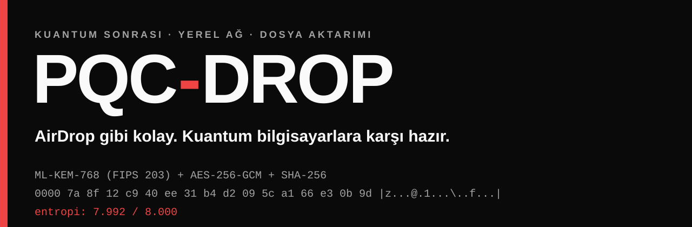
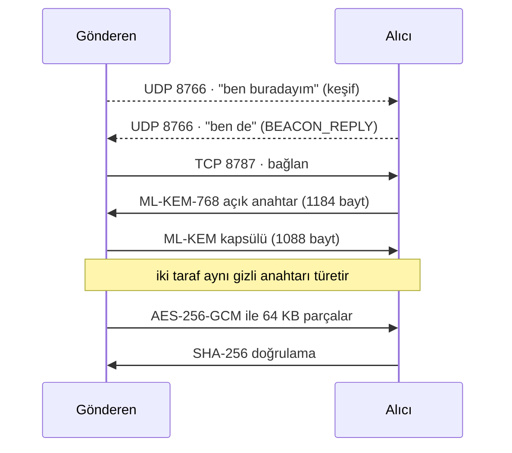

<p align="center">
  
</p>

<p align="center">
  <a href="https://github.com/zynordev/2204a-pqc-kronecker/releases/latest"></a>
  
  
  
</p>

<p align="center"><b>Aynı ağdaki cihazlara dosya gönder. Şifreleme, bir kuantum bilgisayar geldiğinde de dayansın.</b></p>

<p align="center">
  <a href="https://github.com/zynordev/2204a-pqc-kronecker/releases/latest"><b>⬇ İndir (kurulum yok)</b></a> ·
  <a href="#nasıl-çalışır">Nasıl çalışır</a> ·
  <a href="#kanıt-şifreli-mi-gerçekten">Kanıt</a> ·
  <a href="#dürüst-sonuçlar">Dürüst sonuçlar</a>
</p>

---

## Neden var?

Bugün şifrelenip kaydedilen trafik, yıllar sonra yeterince büyük bir kuantum bilgisayarla çözülebilir.
Buna **"şimdi topla, sonra çöz"** (harvest now, decrypt later) deniyor. Bugünkü anahtar değişimi yöntemlerinin çoğu (RSA, X25519) kuantumda kırılır.
NIST 2024'te bunun için **ML-KEM**'i (FIPS 203) standartlaştırdı.

**PQC-Drop**, bu standardı gerçek bir işe koyar: yakındaki cihazı otomatik bulur, tek tıkla dosya yollar ve **şifrelemenin gerçekten çalıştığını ekranda canlı gösterir**.

## 30 saniyede dene

```bash
# 1. İndir ve aç (Python / kütüphane kurulumu gerekmez)
tar -xzf pqc-drop-v1.0.0-linux-x86_64.tar.gz && cd pqc-drop-v1.0.0-linux-x86_64

# 2. Başlat — iki cihazda da çalıştır, birbirini kendisi bulur
./run-gui.sh      # masaüstü arayüzü
./run-tui.sh      # terminal / SSH arayüzü (Raspberry Pi'de de çalışır)
```

> Güvenlik duvarı: **UDP 8766** (keşif) ve **TCP 8787–8802** (aktarım) açık olmalı.
> Paket Linux x86_64 içindir. Diğer platformlarda kaynaktan çalıştır ([aşağıda](#kaynaktan-çalıştır)).

## Ne yapar?

| | |
|---|---|
| 📡 **Otomatik keşif** | Aynı ağdaki cihazlar birbirini bulur. Her cihazın bir adı var, istersen **görünmez** olursun. |
| 🔐 **Kuantuma dayanıklı** | ML-KEM-768 anahtar değişimi + AES-256-GCM + SHA-256 bütünlük doğrulaması. |
| 🔬 **Canlı denetçi** | Wireshark tarzı paket listesi, 16 baytlık hex/ASCII dökümü ve Shannon entropi ölçer. |
| 🖥️ **İki arayüz** | Siyah-beyaz, keskin köşeli masaüstü GUI ve headless cihazlar için ASCII terminal arayüzü. |
| 🎓 **Anlatan arayüz** | "Nasıl çalışır?" sekmesinde lise düzeyinde küçük simülatörler. |

## Nasıl çalışır?



Ağdan geçen her bayt şifreli parçalardır. Anahtar hiç ağa çıkmaz, yalnızca KEM kapsülü gider.

## Kanıt: şifreli mi gerçekten?

Aynı 16 KB'lık içerik üç şekilde gerçek TCP soketiyle yollandı ve `.pcap` olarak kaydedildi ([deney 05](experiments/05-ag-analizi/sonuc.md)):

| | Düz HTTP | TLS 1.3 | **PQC-Drop** |
|---|:---:|:---:|:---:|
| Shannon entropisi (maks. 8) | 4,130 | 7,989 | **7,992** |
| Wireshark'ta düz metin araması | ⚠️ ifşa | ✅ 0 eşleşme | ✅ 0 eşleşme |
| Açık anahtar boyutu | — | 32 bayt | 1184 bayt |
| Kuantuma karşı (Shor) | yok | ❌ kırılır (X25519) | 🛡️ dirençli (kafes tabanlı) |
| Toplam trafik | 16 493 B | 16 435 B | 18 684 B |

Entropi 8'e ne kadar yakınsa veri o kadar rastgele görünür, yani okunabilir bir şey sızmıyor. Bedeli: TLS 1.3'e göre ~2,2 KB ek trafik (1184 baytlık açık anahtar + 1088 baytlık kapsül).
Kendin de bakabilirsin: `tcpdump -r experiments/05-ag-analizi/pqcdrop_gercek.pcap`

## Altındaki fikir: Kronecker ikamesi

ML-KEM'in en sık yaptığı iş polinom çarpımıdır. Biz bunu klasik NTT yerine **Kronecker ikamesiyle** yapıyoruz:
polinomun tüm katsayılarını tek bir dev tamsayıya paketle, tek seferde çarp, sonucu geri aç.

Kilit nokta, katsayıların **ne kadar yer kapladığı**:

- Klasik paketleme katsayı başına **32 bit** ayırır.
- ML-KEM'de çarpanlardan biri hep küçüktür (gizli vektör). Katsayıları sıfırın çevresinde (işaretli) tutunca ayrılması gereken alan **22 bite** iner (η=3; η=2'de 21 bit).
- Gereken genişlik kesin bir formülle ispatlandı: `ℓ_min = bitlen(n·A·η) + 1`. Bir bit eksik olursa çarpım bozulur ([docs/04-teori.md](docs/04-teori.md)).

Yeni bir şifreleme algoritması icat etmedik. NIST standardının içindeki çarpımı, literatürdeki bir yöntemin merkezlenmiş varyantıyla inceledik.

## Dürüst sonuçlar

Bu bölüm bilerek abartısızdır:

| Ölçüm | Sonuç |
|---|---|
| Sadece büyük tamsayı çarpımı (32→22 bit) | **2,05× daha hızlı** (20,35 → 9,94 µs) |
| Tek polinom çarpımı, saf Python | Kronecker, Python NTT'den **2,2× hızlı** |
| Tam ML-KEM-768 (KeyGen+Encaps+Decaps) | Kronecker **0,85×**, yani standart NTT daha hızlı |
| ESP32 (gerçek donanım, 100 çalıştırma) | Kronecker/Comba okul yöntemine göre **0,81×**; sonuçlar %100 doğru |
| Bellek | Paketlenen alan 8192 → 5632 bit (%31 küçük); ama Python'da tepe tahsis **%56,9 arttı** |

**Yani:** yöntem matematiksel olarak doğru ve çarpma adımı gerçekten hızlanıyor. Ancak veriyi NTT alanına/alanından dönüştürmek bu kazancı yiyor, bu yüzden ML-KEM'in tamamında standart yöntem hâlâ önde. Bunu saklamıyoruz.

Bir bulgu daha: sınırın **altına** inmek sadece hata değil, güvenlik açığı. Seçilmiş girdilerle çarpımın bozulup bozulmaması gizli anahtarın normuna bağlı hâle geliyor ([deney 03](experiments/03-guvenlik/sonuc.md)). Kısaca: bit sayısı keyfî seçilemez.

## Nerelerde çalıştırdık?

Aynı fikri üç farklı donanımda, iki farklı şekilde denedik: **algoritma ölçümü** ve **uygulama (PQC-Drop)**.

| Donanım | Ne yaptık | Nerede |
|---|---|---|
| 💻 **x86_64 bilgisayar** (Intel i3-14100 ve laptop, Linux) | Performans (E3) ve IoT benchmark deneyleri, 1884 testin tamamı, masaüstü GUI | [E3](experiments/04-performans/sonuc.md), [IoT](experiments/06-iot-benchmark/sonuc.md) |
| 🍓 **Raspberry Pi 5** (ARM64) | Ön ölçüm, doğruluk deneyi, NIST testleri, **GUI/TUI ile gerçek dosya aktarımı** | [E0](experiments/00-on-olcum/sonuc.md), [E1](experiments/01-dogruluk/sonuc.md) |
| 🔌 **ESP32** (Xtensa, gerçek kart) | C ile polinom çarpımı, çevre sayacıyla ölçüm | [ESP32](experiments/07-esp32-donanim/sonuc.md) |

### 🍓 Raspberry Pi 5

- **Ön ölçüm (E0)**, tek polinom çarpımı, Python, medyan:

  | Yöntem | Süre |
  |---|---:|
  | Okul yöntemi | 9773 µs |
  | NTT (saf Python) | 903 µs |
  | Kronecker, işaretsiz 32 bit | 607 µs |
  | Kronecker, mod 2^(256·22)+1 | **420 µs** |
  | Yalnız bigint çarpımı: 8192 bit / 5632 bit | 47,8 / 24,7 µs (**1,93×**) |

  Bu ön ölçüm sadece "fikir işe yarar mı?" içindi. Sonraki deneyler bunun yerine geçti.
- **Doğruluk (E1):** 8 Kronecker varyantının her biri 10.000 rastgele örnekte **0 hata** verdi (405 sn).
- **Referans ML-KEM hızı (NTT):** ML-KEM-768 keygen 13,0 ms, encaps 18,5 ms, decaps 19,5 ms.
- **NIST testleri:** 225/225 ACVP vakası geçti. Pi bu testlerin ana koşucusuydu.
- **Ders:** Bilerek bozduğumuz bir koddaki sonsuz döngü büyük olasılıkla Pi'yi çökertti. Bundan sonra riskli işler bellek sınırı (`prlimit`) ve `nice` ile çalıştırıldı ve mutasyon aracına zaman aşımı eklendi ([kayıt](docs/kayit/2026-10-27-asama-2.md)).
- **PQC-Drop:** TUI doğrudan Pi'de çalışır. Laptop (GUI) ile Pi (TUI) arasında gerçek bir kabloyla (1 Gbps) ve Wi-Fi'da karşılıklı keşif ve dosya aktarımı denendi. Bu sırada GUI'de gerçek bir hata bulundu ve düzeltildi: keşif paketleri geliyordu ama arayüze iş parçacığından güvenli iletilmediği için laptop Pi'yi listelemiyordu.

### 🔌 ESP32

Gerçek bir **ESP32-D0WD-V3** kartında (çift çekirdek Xtensa LX6, 80 MHz) [`esp32_pqc_benchmark.ino`](experiments/07-esp32-donanim/esp32_pqc_benchmark.ino) çalıştırıldı. Çevre sayacı (`esp_cpu_get_cycle_count`) ile **100 ardışık çalıştırma**, N=256, q=3329:

| Yöntem | Çevrim | Süre | Hız |
|---|---:|---:|---:|
| Okul yöntemi | 677.956 | 8,47 µs | 1,00× |
| Merkezlenmiş Kronecker / Comba (24 bit) | 841.234 | 10,51 µs | **0,81×** |

Sonuç %100 doğru (256 katsayının hepsi eşleşti). Ama Kronecker yöntemi bu kartta **daha yavaş** çıktı. Bu, x86 ve Pi'deki uçtan uca ML-KEM sonucuyla (0,85×–0,90×) aynı yönde. Ayrıca: bu ESP32 kodu paketli tamsayı yerine Comba tipi bir çarpım-toplama çekirdeği kullanıyor. Yani "Kronecker fikrinin ESP32 için bir uyarlaması", birebir aynı Python algoritması değil. Enerji ve yan kanal güvenliği ölçülmedi.

### 🖥️ PQC-Drop uygulaması (GUI + TUI)

Aynı çekirdeği kullanan iki arayüz var:

| | GUI (`pqcdrop-gui`) | TUI (`pqcdrop-tui`) |
|---|---|---|
| Teknoloji | PyQt6 | curses (ASCII) |
| Nerede | Masaüstü | SSH / headless (Raspberry Pi) |
| Keşif radarı, görünürlük açma-kapama | ✅ | ✅ (`V`, `R`) |
| Dosya gönderme / alma | ✅ | ✅ (`S`) |
| Canlı hex/ASCII + entropi | ✅ | ✅ (↑/↓ ile paket seç) |
| Rakip kıyaslama ve simülatör sekmeleri | ✅ | — |

İkisi de aynı UDP 8766 keşif protokolünü ve aynı aktarım motorunu konuşur, yani GUI'deki bir cihaz TUI'deki cihazı görür ve dosya yollayabilir.

> Not: PQC-Drop varsayılan olarak 24 bitlik motoru (`isaretli24-bayt-negmod`) kullanır. Arayüzlerde geçen "22-bit" ifadesi teorik sınırı anlatır.

## Güvenlik notu

PQC-Drop bir **araştırma prototipidir**: bağımsız güvenlik denetiminden geçmedi. Önemli veriler için denetlenmiş araçları kullan. ML-KEM kısmı NIST'in resmî test vektörlerinin hepsini (225/225) geçer, ancak bu bütün sistemin güvenli olduğunu kanıtlamaz.

## Kaynaktan çalıştır

```bash
git clone https://github.com/zynordev/2204a-pqc-kronecker.git && cd 2204a-pqc-kronecker
python3 -m venv .venv && . .venv/bin/activate
pip install -e '.[dev]'
pytest                 # 1884 test
./pqcdrop-gui.sh       # PyQt6 gerekir; yoksa TUI'ye düşer
./pqcdrop-tui.sh
```

Kendi paketini derlemek için: `pip install pyinstaller && pyinstaller --onefile --paths src src/pqc/gui.py`

## Depo haritası

```
src/pqc/        ML-KEM, çarpım yöntemleri ve PQC-Drop (engine · discovery · gui · tui)
tests/          NIST ACVP vektörleri dahil otomatik testler
experiments/    00 ön ölçüm · 01 doğruluk · 02 teori · 03 güvenlik · 04 performans
                05 ağ analizi (.pcap) · 06 IoT benchmark · 07 ESP32 donanım
docs/           teori, literatür, raporlar, kararlar (ADR)
```

Daha derin okumak için: [teori ve ispatlar](docs/04-teori.md) · [sadeleştirilmiş rapor](docs/rapor-sade.md) · [literatür](docs/02-literatur.md) · [IoT mimarisi](docs/mimari-iot.md)

---

<sub>**Lisans:** Kaynak kodu şeffaflık ve tartışma için herkese açıktır; ancak açık kaynak değildir. Okuyabilir, çalıştırıp sonuçları doğrulayabilir, atıfla alıntılayabilir ve tartışabilirsin. Fork'lamak serbesttir. Kopyalamak, değiştirmek, dağıtmak, kendi projende kullanmak ve **bu çalışmayı veya türevini herhangi bir yarışmaya/başvuruya (TÜBİTAK 2204-A dahil) başkası adına sunmak yasaktır**; yazılı izin gerekir. Ayrıntı: [LICENSE](LICENSE).</sub>

<sub>Bu çalışma bir **TÜBİTAK 2204-A** lise araştırma projesi olarak başladı; proje dokümanları [`docs/`](docs/) ve [`danisman/`](danisman/) altında duruyor. Yazar: Halil Erdem Yanık · [ZynorDev](https://github.com/zynordev)</sub>
