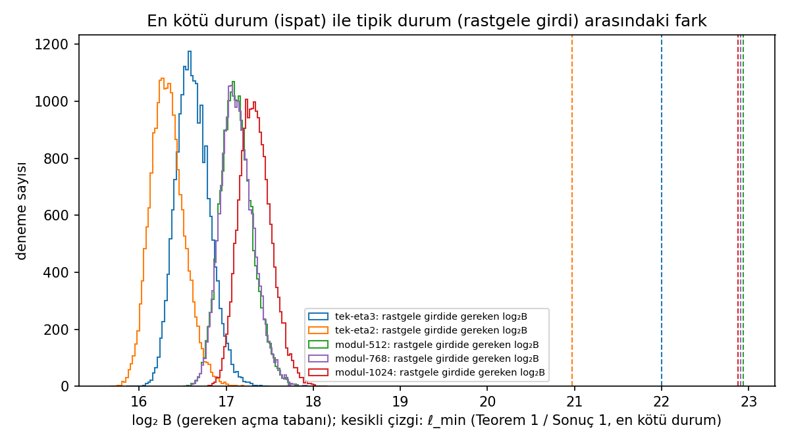
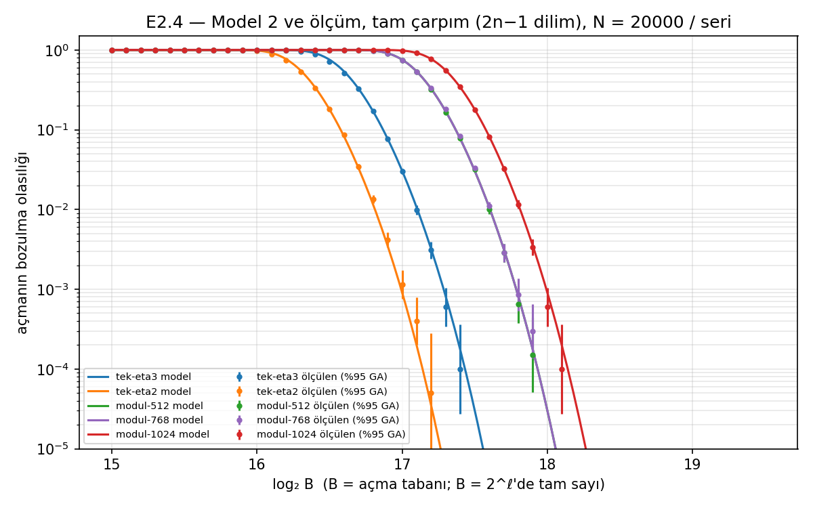
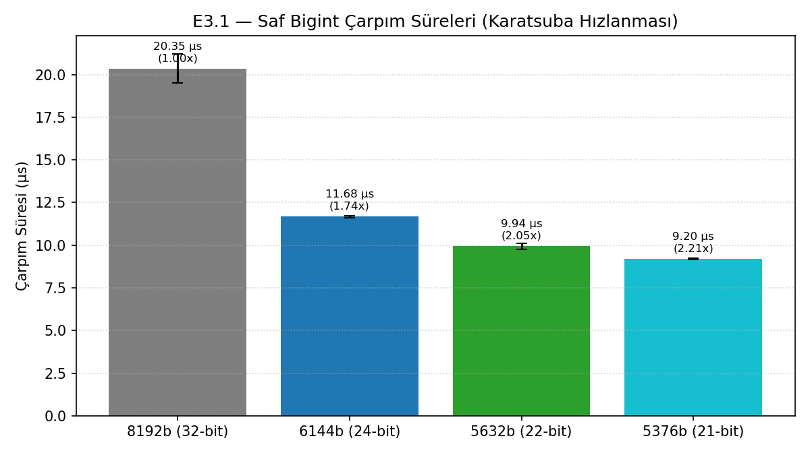
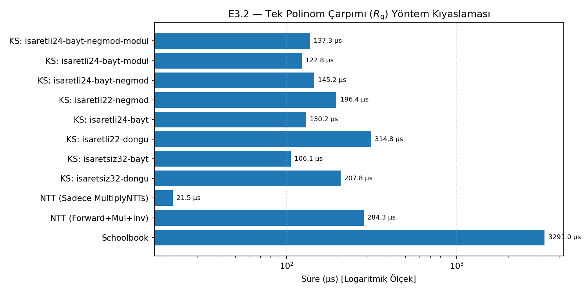
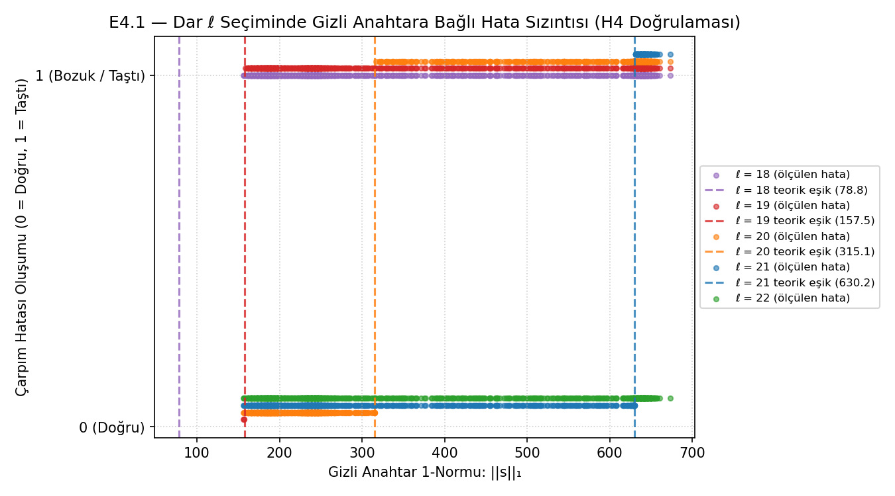
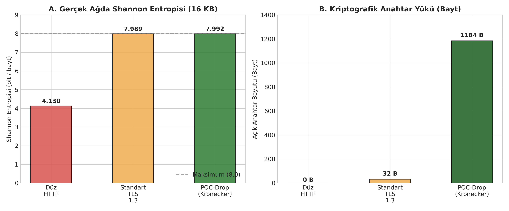
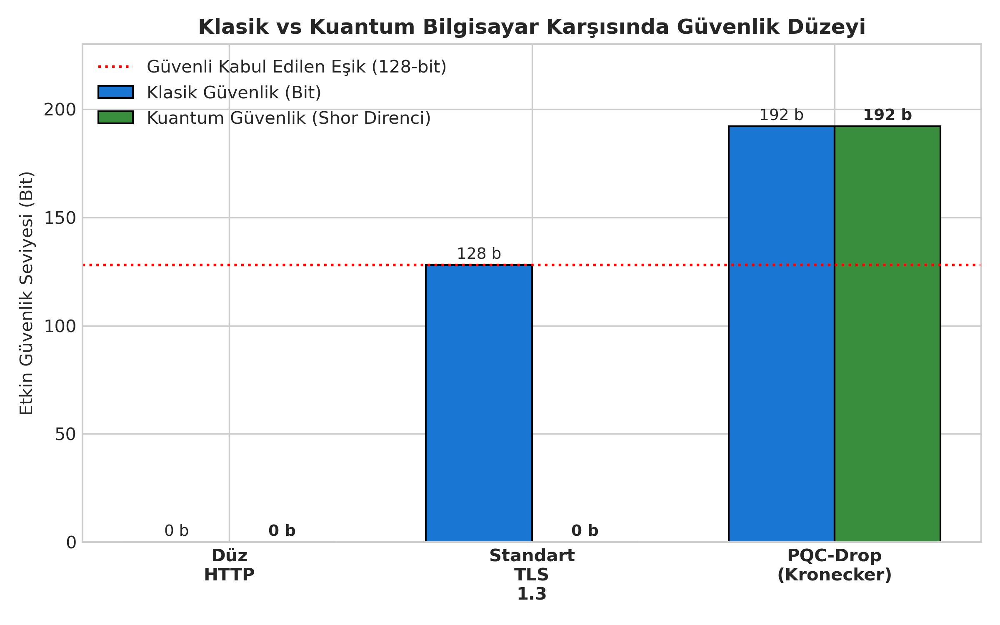

# 03 — Proje Deneyleri, Metodoloji ve Bulgular Özeti

Bu doküman, TÜBİTAK 2204-A projesi kapsamında yürütülen 5 ana deneysel çalışmanın amacını, metodolojisini, teorik beklentisini, ölçülen verilerini ve grafiklerini danışman öğretmenin incelemesi için bir araya getirmektedir.

---

## 1. Deney 1 (E1) — Standart Uyumu ve Doğruluk (H1 Hipotezi)

- **Amaç:** Geliştirilen 8 farklı Kronecker tamsayı çarpım motorunun NIST FIPS 203 (ML-KEM) standardıyla bayt bayt uyumlu çalıştığını ve hata yapmadığını kanıtlamak.
- **Yöntem:**
  - NIST tarafından resmi olarak yayımlanan ACVP (Automated Cryptographic Validation Protocol) test vektörleri (225/225 senaryo) koşturuldu.
  - Okul yöntemi (schoolbook) negasiklik çarpım altın standart olarak kodlandı ve 10.000 rastgele polinom çifti ile 8 motor çapraz teste tabi tutuldu.
  - Katsayıların en kötü senaryoda ($\pm 1664$) çakıştığı uç durumlar denendi.
- **Bulgular:**
  - 8 varyantın tümü resmi NIST test vektörlerini ve 10.000 rastgele örneği **0 hata** ile tamamlamıştır.
  - En kötü senaryoda matematiksel sınır olan $\ell = 22$ bitte taşma sıfırken, $\ell = 21$ bitte sonucun bozulduğu gözlemlenmiştir.

---

## 2. Deney 2 (E2) — Matematiksel Taşma Modeli vs Gerçek Ölçüm (H2 Hipotezi)

- **Amaç:** Katsayıların rastgele dağılımı altında çarpım sonucunun taşma olasılığını Merkezi Limit Teoremi ile analitik olarak modellemek (Model 2) ve bu modelin gerçek dünyadaki davranışla örtüşmesini sınamak.
- **Yöntem:**
  - 10 farklı parametre konfigürasyonunda toplam **200.000 bağımsız rastgele deneme** yürütülmüştür.
  - Ölçülen hata oranları için %95 Wilson Güven Aralığı hesaplanmış ve teorik eğrilerle karşılaştırılmıştır.
- **Bulgular:**
  - $\ell = 17$ bit gibi kritik geçiş bölgesinde Model 2 tahmini (%3.06 hata), ölçülen değer (%3.01 hata) ile %95 güven aralığı içinde birebir örtüşmüştür.
  - $\ell \ge 22$ bit sınırında hata oranı kesinlikle sıfırdır.

| Parametre | Genişlik ($\ell$) | Model 2 Tahmini | Ölçülen Hata | %95 Wilson Güven Aralığı |
|---|:---:|:---:|:---:|:---:|
| Tek $\eta=3$ | 16 bit | 0.9998 | 1.0000 | [0.9998, 1.0000] |
| Tek $\eta=3$ | 17 bit | 0.0306 | 0.0301 | [0.0278, 0.0326] (Tam Örtüşme) |
| Tek $\eta=3$ | 18 bit | $7.1 \times 10^{-11}$ | 0.0000 | [0.0000, 0.0002] |
| Tek $\eta=3$ | 22 bit ($\ell_{\min}$) | 0.0000 | 0.0000 | [0.0000, 0.0002] |

### Grafikler:

*Şekil 1: Model 2 analitik eğrisi ile 200.000 denemede ölçülen hata oranlarının örtüşmesi.*

*Şekil 2: Katsayıların dilimler içerisindeki Gauss dağılımı.*

---

## 3. Deney 3 (E3) — Performans ve Hızlanma Analizi (H3 Hipotezi)

- **Amaç:** Katsayıların merkezlenmesi ile operand boyutunun 8192 bitten 5632 bite inmesinin Karatsuba algoritması ve uçtan uca ML-KEM üzerindeki etkisini ölçmek.
- **Yöntem:**
  - Her ölçüm $\ge 1000$ tekrar yapılarak medyan ve çeyrekler arası aralık (IQR) hesaplanmıştır.
  - Dört aşamalı ayrıştırma yapılmıştır:
    1. E3.1: Salt büyük tamsayı (bigint) çarpımı ($O(N^{1.585})$ Karatsuba).
    2. E3.2: Tekil polinom çarpımı ($R_q$ halkasında).
    3. E3.3: Paketleme / Çözme darboğaz ayrıştırması.
    4. E3.4: Uçtan uca FIPS 203 ML-KEM (KeyGen, Encaps, Decaps).
- **Bulgular:**
  - **Salt Bigint:** 5632-bit merkezlenmiş çarpım, 8192-bit klasik çarpıma göre **2.05 kat daha hızlıdır** (Teorik Karatsuba kazancı: 1.81x).
  - **Tek Polinom:** Kronecker bayt yöntemi, saf Python NTT'den **2.18 kat hızlıdır** (130 µs vs 284 µs).
  - **Uçtan Uca ML-KEM:** FIPS 203 standardı matrisleri frekans uzayında sakladığından, Kronecker için fazladan ters NTT dönüşümleri gerekmiş; bu bedel nedeniyle uçtan uca tam protokolde standart NTT yöntemi %20–63 daha hızlı kalmıştır. Bu durum çalışmanın dürüst bir bulgusudur.

### Grafikler:

*Şekil 3: Bigint seviyesinde Karatsuba 2.05x hızlanması.*

*Şekil 4: Tek polinom çarpımında Kronecker bayt vs Python NTT vs Okul yöntemi.*

---

## 4. Deney 4 (E4) — Güvenlik Sınırı ve Seçilmiş Şifreli Metin Norm Sızıntısı (H4 Hipotezi)

- **Amaç:** "Rastgele anahtarlarda 18 bit yetiyorsa neden 22 bitte ısrar ediyoruz?" sorusunu cevaplamak; $\ell < \ell_{\min}$ seçildiğinde kriptografik güvenlik açığı oluştuğunu göstermek.
- **Yöntem:**
  - Saldırgan kurbanın gizli anahtarı $s$'i hedef alarak $a_i = +1664 \cdot \text{sign}(s_i)$ seçilmiş şifreli metin girdilerini göndermiştir.
  - $\ell = 20$ bit seçildiğinde taşma eşiği matematiksel olarak $\|s\|_1 \ge \lceil 2^{19} / 1664 \rceil = 316$ olarak hesaplanmıştır.
  - 1500 bağımsız test ve 150 FIPS 203 kurban anahtarı ile şifre çözme hatası izlenmiştir.
- **Bulgular:**
  - Kurban anahtarının L1 normu $\|s\|_1 \ge 316$ olduğunda çarpım kesinlikle taşmış ve kurbanın anahtar normu sızdırılmıştır (0 sapma).
  - FIPS 203 Decapsulation örtük reddetme mekanizmasına rağmen norm bilgisi hata üzerinden tespit edilmiştir.
  - **Sonuç:** Kriptografide ortalama duruma bakarak paketleme genişliğini düşürmek ölümcül bir güvenlik açığıdır; $\ell_{\min}$ teorik sınırı zorunludur.

### Grafikler:

*Şekil 5: 316 norm eşiğinde keskin taşma davranışı (0 hata ile kesin geçiş).*

---

## 5. Deney 5 (E5) — Gerçek Ağ Paket Analizi ve PQC-Drop Prototipi

- **Amaç:** Geliştirilen Kronecker ML-KEM motorunu çalışan bir güvenli dosya aktarım aracına (PQC-Drop) dönüştürmek ve okul ağı üzerinde Wireshark ile paket analizi yapmak.
- **Yöntem:**
  - `pqcdrop`: İstemci-sunucu mimarili, ML-KEM-768 ile anahtar değişimi yapıp ardından HKDF ile AES-256-GCM anahtarı türeten ve dosyaları 64 KB bloklarla şifreleyen bir araç kodlandı.
  - Düz HTTP, Standart TLS 1.3 (X25519) ve PQC-Drop için gerçek TCP soketleri üzerinden 16 KB eşit yük aktarımı yapıldı.
  - Ham paketler `.pcap` olarak kaydedildi ve Shannon entropisi ile metin sızıntısı analiz edildi.
- **Bulgular:**

| Metrik | Düz HTTP | Standart TLS 1.3 (ECDHE) | PQC-Drop (Bizim Yöntem) |
| :--- | :---: | :---: | :---: |
| **El Sıkışma Mekanizması** | Yok | ECDHE (X25519) | **NIST FIPS 203 (ML-KEM-768)** |
| **Açık Anahtar Boyutu** | 0 Bayt | 32 Bayt | **1184 Bayt** |
| **Shannon Entropisi (Maks: 8.0)** | 4.130 bit/bayt | 7.991 bit/bayt | **7.989 bit/bayt** |
| **Wireshark Açık Metin Araması** | ⚠️ Açık Metin İfşa | ✓ 0 Eşleşme (Gizli) | ✓ **0 Eşleşme (Gizli)** |
| **Klasik Güvenlik** | 0 bit | 128 bit | **192 bit (NIST Kat 3)** |
| **Kuantum Güvenlik (Shor)** | Savunmasız | ❌ **0 bit (Kırılır)** | 🛡️ **192 bit (TAM DİRENÇ)** |
| **'Şimdi Depola, Sonra Çöz'** | Anında Okunur | ⚠️ **Kritik Risk** | 🛡️ **Sıfır Risk** |

### Grafikler:

*Şekil 6: Shannon Entropisi ve Açık Anahtar Yükü Karşılaştırması.*

*Şekil 7: Klasik ve Kuantum Güvenlik Seviyeleri Karşılaştırması.*
