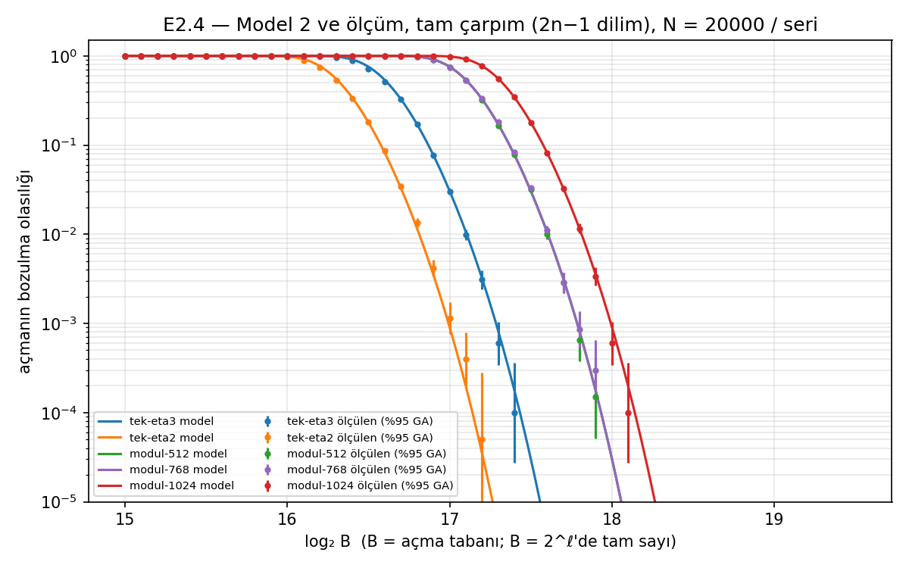
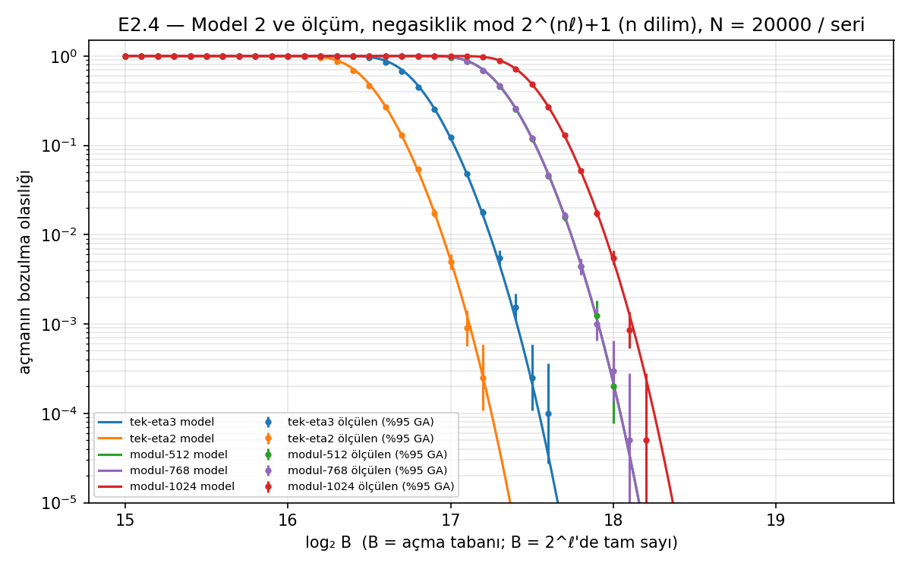
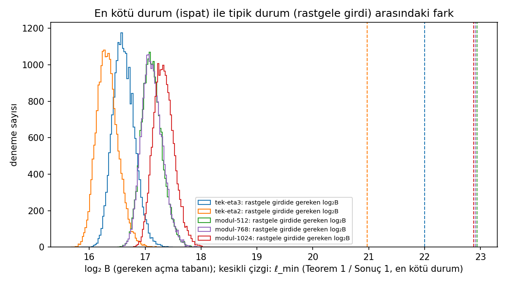
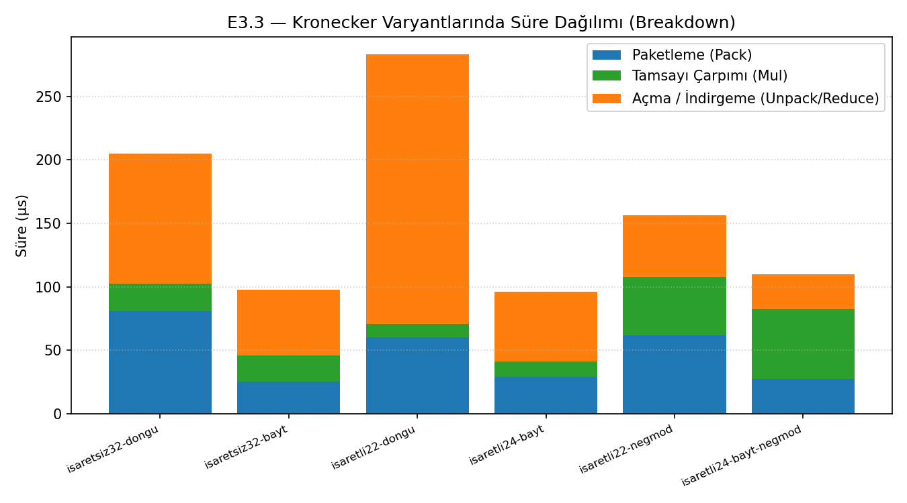
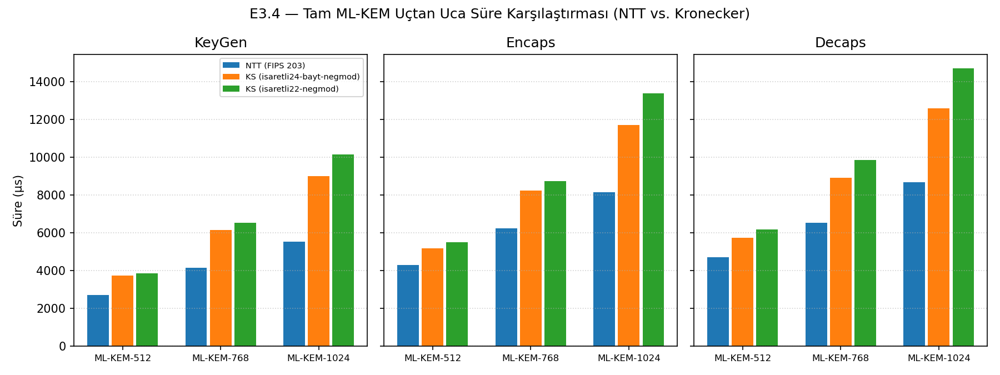
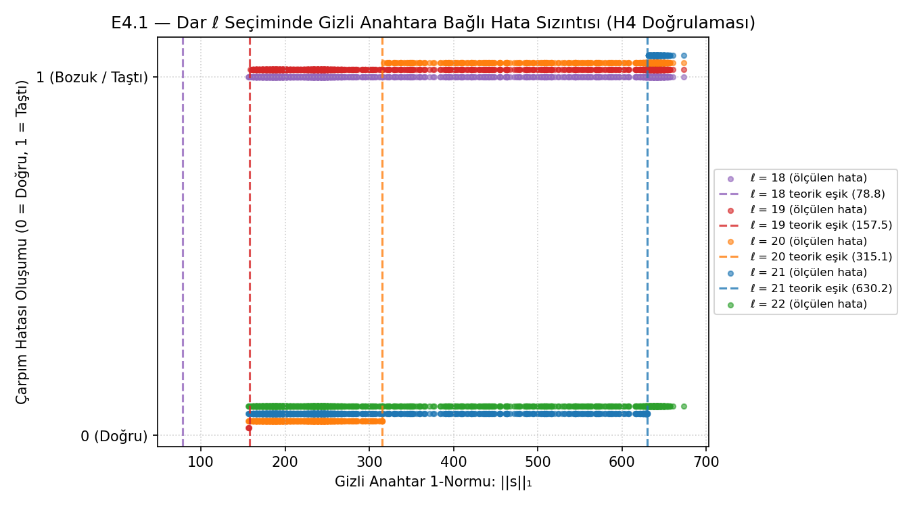

# TÜBİTAK 2204-A Lise Öğrencileri Araştırma Projeleri Yarışması — Proje Raporu

**Proje Ana Alanı:** Yazılım
**Proje Tematik Alanı:** Siber Güvenlik
**Proje Adı (Başlığı):** Kuantum Sonrası Şifrelemede Eldesiz Çarpma: ML-KEM Polinom Çarpımı İçin Merkezlenmiş Kronecker İkamesinde Gereken Bit Genişliğinin İspatı ve Deneysel Sınanması

---

## Özet

Bugün internette anahtar değişimini koruyan yöntemler, yeterince büyük bir kuantum bilgisayarla kırılabilecektir. Bu tehdide karşı 2024'te standartlaştırılan ML-KEM (FIPS 203) yönteminin en sık yaptığı işlem, 256 katsayılı polinomların çarpımıdır. Bu çalışmada bu çarpım, polinomun bütün katsayılarını tek bir büyük tamsayıya yerleştirip tek seferde çarpan Kronecker ikamesiyle yapılmış ve şu soru araştırılmıştır: Sonuç bozulmadan, her katsayıya en az kaç bit ayrılmalıdır? Katsayılar sıfırın çevresinde gösterildiğinde gereken genişliğin ℓ = bitlen(n·A·η) + 1 olduğu ispatlanmış; bu değer ML-KEM-512 için 22, diğer parametre setleri için 21 bittir ve bir bit eksiği kesin hata verir. Sekiz farklı uygulama, standardın resmî test vektörlerinden ve 10.000 rastgele örnekten hatasız geçmiştir. Rastgele girdilerde hata olasılığını öngören model 200.000 denemeyle sınanmış; hatanın seyrek olduğu bölgede ölçümlerin %95 güven aralığı içinde kalmış, hatanın sık olduğu bölgede ise oranı en çok 1,6 puan fazla tahmin etmiştir. Büyük tamsayı çarpımı 32 bitlik yalın paketlemeye göre 2,05 kat hızlanmış; buna karşın ML-KEM'in tamamında standart yöntem %12–63 daha hızlı kalmıştır. Genişlik ispatlanan sınırın altına indirildiğinde, çarpımın bozulup bozulmamasının gizli anahtarın büyüklüğüne bağlı hâle geldiği gösterilmiştir. Yöntem, PQC-Drop adlı dosya aktarım prototipinde kullanılmış; çarpımın iki biçimi ayrıca bir ESP32 kartında ölçülmüştür. Çalışma, bit genişliğinin deneme sonuçlarına göre değil ispata göre seçilmesi gerektiğini ve tek bir adımdaki hızlanmanın bütüne aynen yansımadığını ortaya koymaktadır.

**Anahtar kelimeler:** kuantum sonrası kriptografi, ML-KEM, Kronecker ikamesi, polinom çarpımı, taşma sınırı

---

## 1. Amaç

Bu projenin amacı, ML-KEM standardındaki polinom çarpımının Kronecker ikamesiyle hangi koşullarda **doğru**, hangi koşullarda **hızlı** ve hangi koşullarda **güvenli** yapılabildiğini belirlemektir. Araştırma dört soru çevresinde yürütülmüştür:

1. Katsayılar sıfırın çevresinde (merkezlenmiş) gösterildiğinde, çarpımın katsayıları birbirine karışmadan geri okunabilmesi için katsayı başına en az kaç bit gerekir? Bu sınır gerçekten en küçük müdür?
2. Rastgele girdilerde daha dar genişlikler ne sıklıkla hata verir? Bu sıklık önceden hesaplanabilir mi?
3. Daha dar paketleme, büyük tamsayı çarpımını, tek bir polinom çarpımını ve ML-KEM'in tamamını ne kadar hızlandırır?
4. Genişlik sınırın altında seçilirse hatanın ortaya çıkması gizli anahtara bağlı mıdır?

Bu sorulara karşılık dört hipotez kurulmuştur:

- **H1 (doğruluk):** Kronecker ile çarpım yapan ML-KEM, standardın resmî test vektörleriyle bayt bayt aynı çıktıyı verir.
- **H2 (teori–deney uyumu):** İspatlanan sınır her girdi için yeterlidir ve bir bit eksiği yetersizdir; rastgele girdilerdeki hata oranı olasılık modelinin öngördüğü değerdedir.
- **H3 (performans):** Paketlenen sayı 8192 bitten 5632 bite indiğinde büyük tamsayı çarpımı yaklaşık 1,8 kat hızlanır; bu kazanç ML-KEM'in tamamına aynı oranda yansımaz.
- **H4 (güvenlik):** Sınırın altındaki genişliklerde, özel seçilmiş bir girdide çarpımın bozulup bozulmaması gizli vektörün mutlak değerleri toplamına (‖s‖₁) bağlıdır.

Her hipotezin beklenen sayısal sonucu deneyden önce yazılmış, sonradan değiştirilmemiştir.

## 2. Giriş

### 2.1. Neden Yeni Bir Şifreleme Yöntemine İhtiyaç Var?

İki tarafın daha önce hiç buluşmadan ortak bir gizli anahtar kurması, internetteki güvenli bağlantıların temelidir. Bir web sitesine bağlanırken, bir mesajlaşma uygulamasında yazışırken ya da e-Devlet'e girerken önce bu anahtar kurulur, sonra bütün veri bu anahtarla şifrelenir. Bugün bu iş için kullanılan RSA ve eliptik eğri yöntemlerinin güvenliği, büyük sayıları çarpanlarına ayırmanın ve ayrık logaritma hesaplamanın zorluğuna dayanır. Shor (1994), bu iki problemi kuantum bilgisayarda verimli biçimde çözen bir algoritma vermiştir. Yeterli büyüklükte bir kuantum bilgisayar henüz yoktur. Ancak bugün kaydedilen şifreli trafik ileride çözülebilir ("şimdi topla, sonra çöz"). Bu yüzden geçişin şimdiden yapılması gerekmektedir. Bu amaçla ABD Ulusal Standartlar ve Teknoloji Enstitüsü (NIST), Ağustos 2024'te ML-KEM anahtar kapsülleme standardını yayımlamıştır (NIST, 2024). ML-KEM, Kyber algoritmasından türetilmiştir (Bos ve ark., 2018). Güvenliği RSA'daki gibi çarpanlara ayırmaya değil, "gürültü eklenmiş" denklemlerden gizli sayıları bulmanın zorluğuna (modül üzerinde hatalarla öğrenme problemi) dayanır. Bu problemi kuantum bilgisayarda hızlı çözen bilinen bir yöntem yoktur.

### 2.2. Polinom Nedir, Şifrelemede Ne İşe Yarar?

Polinom, bir sayı listesini tek bir nesne olarak yazmanın yoludur. Örneğin 3, 2 ve 5 sayılarından oluşan liste

  f(x) = 3 + 2x + 5x²

biçiminde yazılır. Buradaki 3, 2 ve 5 sayılarına **katsayı** denir; x ise yalnızca katsayıların sırasını tutan bir yer imidir. Bu projede polinomlar bir fonksiyon çizmek için değil, **sayı paketleri** olarak kullanılır. ML-KEM'de her polinom 256 katsayılıdır, yani her biri 256 sayılık bir kutudur. Anahtarlar, şifreli metin ve şifrelenecek mesaj bu kutular hâlinde tutulur.

ML-KEM'de üç tür polinom vardır ve katsayıları farklı yerlerden gelir:

- **Herkese açık büyük polinomlar (A matrisi):** 32 baytlık rastgele bir "tohum" sayısından, standartta tanımlı bir karıştırma fonksiyonuyla (SHAKE128) üretilir. Katsayıları 0 ile 3328 arasındadır ve hepsi eşit olasılıkla çıkar. Tohum açık anahtarın içinde gönderilir; karşı taraf aynı tohumdan aynı polinomları üretir.
- **Gizli küçük polinomlar (s, e, r):** Katsayıları yalnızca −3 ile +3 (ML-KEM-768 ve ML-KEM-1024'te −2 ile +2) arasındadır. Bir katsayı, η kez atılan iki ayrı yazı-tura dizisindeki tura sayılarının farkıdır. Örneğin η = 2 için birinci dizide 2, ikincisinde 1 tura gelirse katsayı 2 − 1 = +1 olur. Bu yüzden 0 en sık, ±2 en seyrek çıkan değerdir (olasılıklar sırasıyla 6/16, 4/16 ve 1/16).
- **Mesaj polinomu:** Gönderilecek 32 baytlık (256 bitlik) sırrın her biti bir katsayıya yerleştirilir. Bit 0 ise katsayı 0, bit 1 ise 1665 (3329'un yaklaşık yarısı) olur.

Bütün hesaplar **3329'a göre kalan** ile yapılır. Bu, saat aritmetiğine benzer: 12 saatlik saatte 10 + 5 = 3 olduğu gibi, burada da 3328 + 2 = 1 olur. Aynı mantıkla 3328 sayısı "0'dan bir eksik" yani **−1** olarak da yazılabilir. Projenin temel fikri buna dayanır: katsayılar 0 ile 3328 arasında değil, **sıfırın çevresinde** −1664 ile +1664 arasında yazıldığında (**merkezlenmiş gösterim**) sayıların büyüklüğü yarıya iner.

İkinci kural, polinomun 256 katsayıyla sınırlı kalmasını sağlar: x²⁵⁶ yerine **−1** yazılır. Yani kutunun sonundan taşan bir terim, işareti değişerek başa döner. Küçük bir örnekle, 4 katsayılı polinomlarda x⁴ = −1 alınsın:

  (1 + 2x + 3x³) · (2 + x) = 2 + 5x + 2x² + 6x³ + **3x⁴**

Son terimdeki x⁴ yerine −1 yazılınca 3x⁴ = −3 olur ve başa eklenir: sonuç **−1 + 5x + 2x² + 6x³** bulunur. ML-KEM'de aynı işlem 256 katsayıyla yapılır.

### 2.3. Polinom Çarpımı Nasıl Yapılır ve Neden Önemlidir?

İki polinomu çarpmak için birinin her katsayısı diğerinin her katsayısıyla çarpılır ve aynı kuvvete düşenler toplanır (okul yöntemi):

  (2x + 3) · (4x + 1) = 8x² + 2x + 12x + 3 = **8x² + 14x + 3**

Burada 2·2 = 4 çarpma yapılmıştır. 256 katsayılı iki polinom için bu sayı 256 · 256 = **65.536** çarpmadır. Bir ML-KEM-768 anahtar kurulumunda bu çarpımlardan onlarcası yapılır. Örneğin herkese açık 3×3'lük polinom tablosu, 3 polinomluk gizli vektörle çarpılırken tek başına 9 polinom çarpımı gerekir. Bu nedenle polinom çarpımı yöntemin en sık tekrarlanan işlemidir. Standart bu çarpımı Sayı Teorik Dönüşüm (NTT) adı verilen bir dönüşümle hızlandırır ve açık anahtarı doğrudan bu dönüşmüş biçimde saklar.

### 2.4. Çıkış Noktası: Sayılar Aslında Polinomdur

Bu projenin çıkış noktası ilkokuldan bilinen bir gözlemdir: onluk sistemde yazılan her sayı, x = 10 konmuş bir polinomdur. 23 = 2·10 + 3 ve 41 = 4·10 + 1 olduğundan, 2.3'teki çarpım x = 10'da bir sayı çarpımına dönüşür:

  23 · 41 = (2x + 3)(4x + 1), x = 10 için = 8·100 + 14·10 + 3 = **943**

Ancak 943 sayısına bakarak 8, 14 ve 3 katsayıları geri okunamaz. Ortadaki katsayı (14) 10'dan büyük olduğu için onlar basamağından yüzler basamağına **elde** taşınmış, katsayılar birbirine karışmıştır. Aynı çarpım x = 100 için yapılırsa durum değişir:

  203 · 401 = **8|14|03** = 81.403

Bu kez her katsayı iki basamaklık kendi "kutusuna" sığar ve sayı ikişer basamaklık gruplara ayrılınca 8, 14, 3 katsayıları doğrudan okunur. Buradan projenin sorusu doğmuştur: *Taban en az ne kadar büyük seçilmelidir ki hiç elde oluşmasın ve katsayılar sayının içinden doğrudan okunabilsin?* İki basamaklı sayıların karesinde en büyük katsayı 2·9·9 = 162 olduğundan cevap 163'tür.

Negatif katsayılar da aynı yolla çalışır ve tabanı küçültür. 19 sayısı 1·10 + 9 yerine 2·10 − 1 olarak yazılabilir. O zaman 19² = (2x − 1)² = 4x² − 4x + 1 olur ve x = 10 için 400 − 40 + 1 = 361 bulunur. Katsayılar 0…9 yerine −5…+4 aralığında tutulduğunda, aynı işi yapmak için daha küçük kutular yeter. Bu, 2.2'deki merkezlenmiş gösterimin küçük ölçekli hâlidir.

Bu sorunun genel hâli, polinom çarpımını tek bir büyük tamsayı çarpımına indirgeyen ve Kronecker'e (1882) dayanan **Kronecker ikamesidir**. x yerine yeterince büyük bir sayı (bilgisayarda 2^ℓ) konur, iki tamsayı çarpılır ve sonuç ℓ bitlik dilimlere ayrılarak katsayılar geri okunur. Bilgisayar büyük tamsayıları çok hızlı çarpabildiği için 65.536 küçük çarpma yerine tek bir büyük çarpma yapılmış olur. Gözlemimizin bu yöntemin özel bir hâli olduğu, literatür taraması sırasında öğrenilmiştir.

### 2.5. Literatürdeki Yeri

Kronecker ikamesi hızlı polinom çarpımı alanında uzun süredir incelenmektedir (Harvey, 2009). Kuantum sonrası kriptografide Albrecht ve ark. (2019), Kyber'ı akıllı kartlardaki RSA büyük tamsayı çarpıcısı üzerinde çalıştırmak için bu yöntemi kullanmış ve katsayıların karışmaması için gereken genişliği belirlemiştir; Bos ve ark. (2022) aynı donanım hedefi için daha gelişmiş varyantlar önermiştir. Dolayısıyla işaretli (merkezlenmiş) Kronecker ikamesi ve en kötü durum sınırı literatürde bilinmektedir; bu proje yeni bir şifreleme algoritması ya da yeni bir çarpma yöntemi önermemektedir.

Projenin literatüre göre konumu şudur: (i) FIPS 203'ün kesinleşmiş parametreleri için gereken genişlik, en küçük olduğunu gösteren açık bir örnekle birlikte ispatlanmış; (ii) en kötü durum sınırı ile ML-KEM'in gerçek katsayı dağılımlarında görülen tipik durum arasındaki fark bir olasılık modeliyle hesaplanıp deneyle sınanmış; (iii) bu farkın "denemelerde yetiyor" diyerek daha dar genişlik seçmeyi neden sakıncalı kıldığı gösterilmiş; (iv) hızlanmanın hangi adımdan geldiği ve neden bütüne yansımadığı ayrıştırılmıştır. ML-KEM'de çarpanlardan biri her zaman küçük katsayılıdır (gizli vektörün katsayıları −3 ile +3 arasındadır); çalışma bu özellikten yararlanmaktadır.

## 3. Yöntem

### 3.1. Kullanılan Sayılar ve Nereden Geldikleri

Yöntemin temel sayıları proje ekibi tarafından keyfî olarak seçilmemiştir; hepsi ya standarttan alınmış ya da standarttaki değerlerden hesaplanmıştır (Tablo 1).

**Tablo 1.** Temel sayılar, kaynakları ve anlamları

| Sembol | Değer | Kaynağı | Ne anlama gelir? |
|---|---|---|---|
| n | 256 | FIPS 203 | Her polinomdaki katsayı sayısı (kutunun boyu) |
| q | 3329 | FIPS 203 | Hesapların yapıldığı modül. Asal bir sayıdır ve 3329 − 1 = 13 · 256 olduğu için standardın NTT dönüşümüne uygundur |
| A | 1664 | Hesaplanır: (q − 1)/2 | Büyük katsayının merkezlenmiş gösterimde alabileceği en büyük mutlak değer |
| η | 3 veya 2 | FIPS 203 | Gizli katsayıların sınırı: ML-KEM-512'de −3…+3, ML-KEM-768/1024'te −2…+2 |
| k | 2, 3, 4 | FIPS 203 | Polinom tablosunun boyu (ML-KEM-512, -768, -1024). Büyüdükçe güvenlik artar |
| ℓ | 21–32 | Bu çalışmada hesaplanır | Kronecker ikamesinde her katsayıya ayrılan bit sayısı (kutunun genişliği) |
| 1.277.952 | 256 · 1664 · 3 | Hesaplanır (Teorem 1) | Bir çarpım katsayısının ML-KEM-512'de ulaşabileceği en büyük mutlak değer |

Bir çarpım katsayısının en fazla ne kadar büyüyebileceği sade bir akıl yürütmeyle bulunur. Her sonuç katsayısı en fazla 256 küçük çarpımın toplamıdır. Bu çarpımların her biri en fazla 1664 · 3 = 4992 olabilir. Öyleyse toplam en fazla 256 · 4992 = 1.277.952 olur. Bu en kötü durum ancak bütün büyük katsayılar 1664, bütün gizli katsayılar 3 olduğunda (ya da işaretleri birbirine uyduğunda) ortaya çıkar.

### 3.2. Matematiksel Çerçeve

Bu bölüm, 2.4'teki "taban ne kadar büyük olmalı?" sorusunun ve 3.1'deki akıl yürütmenin matematiksel yazımıdır. Sonuçları 3.3'te sade bir dille özetlenmiştir.

n = 256, q = 3329 alınmıştır. Katsayılar merkezlenmiş biçimde, yani {−1664, …, 1664} aralığında tutulur; A = (q − 1)/2 = 1664'tür. Küçük polinomun katsayıları s_j ∈ [−η, η] aralığındadır (ML-KEM-512'de η = 3, ML-KEM-768 ve ML-KEM-1024'te η = 2). İki polinomun indirgenmemiş çarpımının katsayıları c_k = Σ_{i+j=k} a_i·s_j, X²⁵⁶ = −1 kuralıyla indirgenmiş katsayılar ise d_k = c_k − c_{k+n} biçimindedir.

Kronecker ikamesinde B = 2^ℓ seçilir ve P_a = Σ a_i·B^i, P_s = Σ s_j·B^j tamsayıları oluşturulur. Polinomda x yerine sayı koymak çarpma ve toplamayı koruduğundan P_a·P_s = Σ c_k·B^k olur. Geriye tek soru kalır: c_k'ler bu tamsayıdan tek türlü geri okunabilir mi?

**Lemma 1 (dengeli gösterimin tekliği).** Her rakamı D_ℓ = {−2^(ℓ−1), …, 2^(ℓ−1) − 1} kümesinden olan C = Σ d_k·B^k gösterimi tektir ve rakamlar şu adımla sırayla bulunur: C'nin alt ℓ biti alınır; değer 2^(ℓ−1) veya daha büyükse 2^ℓ çıkarılır; bulunan rakam C'den çıkarılıp sonuç 2^ℓ'ye bölünür. İspat, iki farklı gösterimin ilk ayrıldığı basamakta farkın B'ye bölünmesi gerektiği, oysa farkın mutlak değerinin B'den küçük olduğu çelişkisine dayanır. Bu adım, 19² = (2x − 1)² örneğindeki "ödünç alma" işleminin kendisidir.

**Teorem 1 (gereken genişlik).** |a_i| ≤ A ve |s_j| ≤ η ise her katsayı için |c_k| ≤ n·A·η olur; çünkü bir katsayıya en çok n terim katkı verir. n·A·η < 2^(ℓ−1) ise bütün katsayılar D_ℓ içindedir ve Lemma 1 ile tam olarak geri okunur. Bu koşulu sağlayan en küçük genişlik

**ℓ_min = bitlen(n·A·η) + 1**

olur. η = 3 için n·A·η = 256·1664·3 = 1.277.952 ve ℓ_min = 22; η = 2 için 851.968 ve ℓ_min = 21'dir.

**Önerme 1 (sınır en küçüktür).** Bütün a_i = 1664 ve bütün s_j = η seçilirse c_{n−1} = n·A·η olur. Genişlik bir bit azaltıldığında bu değer D_ℓ'nin dışında kalır ve açma kesinlikle yanlış sonuç verir. Daha genel olarak a_i'lerin işareti s'nin işaretlerine uydurulursa c_{n−1} = 1664·‖s‖₁ elde edilir; yani dar genişlikte hatanın oluşması gizli vektöre bağlıdır (H4'ün dayanağı).

**Önerme 2 (indirgemenin tamsayıda yapılması).** x = 2^ℓ için X^n + 1 ifadesi M = 2^(nℓ) + 1 sayısına karşılık gelir. Çarpımın M'ye göre kalanı alınırsa doğrudan indirgenmiş d_k katsayıları elde edilir; her d_k tam n terim içerdiğinden gereken genişlik değişmez, açılacak dilim sayısı ise 511'den 256'ya iner.

**Sonuç 1 (toplamın açılmadan yapılması).** ML-KEM'de çarpımlar k terimli toplamlar hâlinde gelir (k = 2, 3, 4). Terimler tamsayı olarak toplanıp bir kez açılırsa sınır k·n·A·η olur ve üç parametre setinde de ℓ_min = 23 çıkar; bayt sınırına denk gelen 24 bit üçüne de yeter.

**Tablo 2.** Gereken en küçük genişlikler

| Durum | En büyük katsayı | ℓ_min | 256 katsayının toplam boyutu |
|---|---:|:---:|---:|
| Yalın paketleme (iki çarpan da 0…3328) | 256·3328² = 2.835.349.504 | 32 | 8192 bit |
| Merkezlenmiş, η = 3 (ML-KEM-512) | 1.277.952 | 22 | 5632 bit |
| Merkezlenmiş, η = 2 (ML-KEM-768/1024) | 851.968 | 21 | 5376 bit |
| Merkezlenmiş, toplam açılmadan (üç set) | 2.555.904 – 3.407.872 | 23 | 5888 bit |

### 3.3. Neden 32 Bitten 22 Bite İniyoruz?

Kronecker ikamesinde her katsayıya bir "kutu" ayrılır. Kutu, içine girebilecek en büyük sayıyı alacak kadar geniş olmalıdır; dar olursa 2.4'teki 943 örneğindeki gibi elde taşınır ve katsayılar karışır. Bir bit eklemek kutunun alabileceği sayıyı iki katına çıkarır: ℓ bitlik bir kutu yaklaşık 2^ℓ büyüklüğünde sayı alır (örneğin 2²¹ = 2.097.152, 2³² = 4.294.967.296). İşaretli sayılar için bir bit de artı/eksi işaretine ayrılır.

**Yalın yöntem neden 32 bit ister?** Bilgisayarda hazır sayı türleri genellikle 0'dan başlar. Bu yüzden en yalın uygulama hem büyük hem gizli katsayıları 0…3328 arasında tutar. Bu durumda en büyük çarpım katsayısı 256 · 3328 · 3328 = 2.835.349.504 olur. Bu sayı 2³¹'den büyük, 2³²'den küçüktür; yani 32 bitlik kutu gerekir.

**22 bite iniş iki gözleme dayanır:**

1. *Gizli sayılar aslında çok küçüktür.* Gizli katsayılar 0…3328 değil, −3…+3 arasındadır. Yalın yöntem bunları gereksiz yere 3328'e kadar çıkabilecekmiş gibi hesaplar. Gerçek boyutları kullanılınca en büyük değer yaklaşık 1100 kat küçülür.
2. *Büyük sayılar sıfırın çevresinde yazılabilir.* 0…3328 yerine −1664…+1664 kullanılınca (2.2'deki saat örneği) büyük katsayıların en büyük değeri yarıya iner.

İkisi birlikte uygulanınca en büyük çarpım katsayısı 256 · 1664 · 3 = 1.277.952 olur. Bu sayı 2²⁰ = 1.048.576'dan büyük, 2²¹ = 2.097.152'den küçüktür, yani büyüklüğü için 21 bit yeter. İşaret için bir bit eklenince **22 bit** bulunur. Böylece 256 katsayılık sayı 8192 bitten 5632 bite, yani yaklaşık üçte bir oranında kısalır. Bilgisayar daha kısa sayıları daha hızlı çarptığı için çarpım adımı hızlanır (4.3'te ölçülmüştür: 2,05 kat).

Karşılaştırmanın adil olması için bir not gerekir: yalnızca gizli katsayılar 3 kadar kaydırılıp 0…6 aralığına alınırsa en büyük katsayı 256·3328·6 = 5.111.808 olur ve 23 bit yeter. Yani 32 → 22 bitlik kazancın büyük kısmı küçük çarpanın küçük tutulmasından, son bir biti ise büyük çarpanın merkezlenmesinden gelir.

**Neden 21 ya da 20 bit değil?** 22 bit, *her* olası girdi için yeterli olan en küçük genişliktir. 21 bit seçilirse, bütün katsayıları en büyük değerde olan bir girdide sonuç kesinlikle bozulur (Önerme 1). Rastgele denemelerde bu girdiyle neredeyse hiç karşılaşılmaz ve 18 bit bile yetiyormuş gibi görünür. Ancak 4.4'te gösterildiği gibi, bu durumda sonucun doğru çıkıp çıkmaması gizli anahtara bağlı hâle gelir. Bu yüzden genişlik denemeyle değil, ispatla seçilmiştir. PQC-Drop'ta 22 yerine **24 bit** kullanılmasının nedeni ise bilgisayarın veriyi 8 bitlik baytlar hâlinde daha hızlı işlemesidir (24 = 3 bayt). Ayrıca 24 bit, terimler toplanıp tek seferde açıldığında gereken 23 biti de karşılar.

### 3.4. Basit Bir Şifreleme Örneği: Bir Okul Metnini Şifrelemek ve Çözmek

Yöntemin nasıl çalıştığını somutlaştırmak için iki örnek hazırlanmıştır. İkisi de depodaki `docs/ornekler/okul_metni_sifreleme.py` dosyasıyla yeniden üretilebilir.

**Örnek 1: Tek bir harfin elle izlenebilir şifrelenmesi.** ML-KEM'in fikri, gerçek değerler yerine küçük sayılarla gösterilmiştir: 256 yerine 8 katsayı, 3329 yerine 97 modülü. Şifrelenecek şey "O" harfidir. Bilgisayarda "O" harfi 79 sayısıyla, ikilik sistemde 01001111 olarak tutulur. Bu 8 bit, en sağdaki bitten başlayarak mesaj polinomunun katsayıları olur: m = [1, 1, 1, 1, 0, 0, 1, 0].

**Tablo 3.** "O" harfinin oyuncak ML-KEM ile şifrelenmesi (n = 8, q = 97)

| Adım | Kim yapar? | İşlem | Örnek değerler |
|---|---|---|---|
| 1. Anahtar üretimi | Alıcı | Rastgele bir **a** polinomu ve gizli küçük **s**, **e** seçer; **b = a·s + e** hesaplar. (a, b) herkese açıktır, s gizli kalır | a = [6, 8, −1, 34, 24, 42, 11, 16], s = [1, 0, 1, −1, 0, 0, 0, 0] → b = [36, 2, 21, 36, 15, −20, 1, 35] |
| 2. Şifreleme | Gönderici | Yeni küçük **r**, **e₁**, **e₂** seçer; **u = a·r + e₁** ve **v = b·r + e₂ + 49·m** hesaplar ve (u, v)'yi gönderir | m = [1, 1, 1, 1, 0, 0, 1, 0] → u = [23, 8, −31, −9, 17, 48, 33, −23], v = [−13, 17, 16, 27, −24, −27, 11, 8] |
| 3. Çözme | Alıcı | Gizli s ile **w = v − s·u** hesaplar; 0'a yakın değerler 0, ±49'a yakın değerler 1 bitidir | w = [46, −47, 47, −46, −2, 0, −48, 0] → bitler 01001111 → **"O"** |

Çözmenin neden çalıştığı şöyle açıklanabilir. v − s·u hesaplanınca a·s·r terimleri birbirini götürür ve geriye yalnızca 49·m ile küçük gürültü terimleri (e·r + e₂ − s·e₁) kalır. Bu örnekte gürültü en fazla 3'tür. 0 ile 49 arasındaki farka göre çok küçük olduğu için her bit doğru okunur. Gerçek boyutlarda (256 katsayı, 3329 modülü, k adet polinom), gizli s'yi bilmeyen biri u ve v'deki sayıların rastgele görünen karışımından mesajı ayıramaz. Bu oyuncak örnek ise yalnızca fikri göstermek içindir; sayılar o kadar küçüktür ki tüm olasılıklar denenerek kolayca kırılabilir.

Tablodaki bütün polinom çarpımları (a·s, a·r, b·r, s·u) Kronecker ikamesiyle yapılmış ve okul yöntemiyle karşılaştırılmıştır. Kolay okunsun diye x yerine 2^ℓ değil 1000 konmuştur. Örneğin a polinomu tek bir sayıya dönüştürülünce

  P_a = 16.011.042.024.033.999.008.006

olur. Bu sayı sağdan üçer basamaklı gruplara ayrılınca 006, 008, 999 (yani −1), 033 (yani 34; bir önceki −1 için bir ödünç alındığı için) … biçiminde a'nın katsayıları geri okunur. 1000 tabanının yetip yetmediği de Teorem 1 ile aynı akıl yürütmeyle denetlenmiştir: 8 terim × en fazla 48 × en fazla 1 = 384, ve 384 < 500 olduğundan katsayılar karışmaz.

**Örnek 2: Gerçek bir okul duyurusunun PQC-Drop akışıyla şifrelenmesi.** Aynı fikir gerçek boyutlarda, projenin kendi ML-KEM-768 kodu ve PQC-Drop'un 24 bitlik Kronecker motoruyla çalıştırılmıştır. Şifrelenen metin şudur: *"Okulumuzun bilim şenliği 20 Aralık'ta konferans salonunda yapılacaktır."* Bu metin Türkçe karakterleriyle birlikte 76 bayttır.

1. **Alıcı** anahtar çifti üretir. 1184 baytlık açık anahtarı göndericiye yollar; 2400 baytlık gizli anahtar hiçbir zaman gönderilmez.
2. **Gönderici**, açık anahtarla 1088 baytlık bir kapsül üretip alıcıya yollar. Bu sırada kendi tarafında 32 baytlık bir ortak sır elde eder.
3. **Alıcı**, gizli anahtarıyla kapsülü açar ve aynı 32 baytlık ortak sırrı bulur. Ağı dinleyen biri açık anahtarı, kapsülü ve şifreli metni görür; ortak sırrı ve metni göremez.
4. Ortak sırdan HKDF-SHA256 ile 256 bitlik bir AES anahtarı türetilir. Metin AES-256-GCM ile şifrelenir. 76 baytlık metin 92 baytlık şifreli metne dönüşür; aradaki 16 bayt, metnin değiştirilmediğini denetleyen doğrulama etiketidir.
5. Alıcı aynı anahtarla şifreli metni çözer ve metnin aslıyla bayt bayt aynı olduğu doğrulanır. Şifreli metinde tek bir bit değiştirildiğinde ise çözme reddedilir; yani yolda yapılan bir değişiklik fark edilir.

Örnek çalıştırmada şifreli metnin ilk baytları `636d1bb42c31589d…` olmuştur. Anahtarlar her çalıştırmada rastgele üretildiği için bu baytlar her seferinde farklı çıkar. Metnin çözülüp aslıyla aynı çıkması ise her seferinde değişmez.

### 3.5. Rastgele Girdiler İçin Olasılık Modeli

Teorem 1, bütün katsayıların aynı anda en büyük değerde ve aynı işaretli olduğu en kötü durumu ele alır. ML-KEM'de ise büyük polinomun katsayıları düzgün dağılır (varyansı (q² − 1)/12 = 923.520), küçük polinomunkiler merkezli binom dağılımından gelir (varyansı η/2). Bir çarpım katsayısı, T adet bağımsız terimin toplamı olduğundan Merkezi Limit Teoremi ile yaklaşık normal dağılır: σ² = T·923.520·η/2. Tek bir dilimin D_ℓ dışına çıkma olasılığı p_k ≈ 2Φ(−2^(ℓ−1)/σ_k), çarpımın bozulma olasılığı ise 1 − Π(1 − p_k) olarak modellenmiştir. Modelin iki yaklaşıklığı baştan bilinmektedir: dilimler aynı katsayıları paylaştığı için tam bağımsız değildir ve terimler sınırlı olduğu için gerçek dağılımın kuyruğu normalden incedir.

### 3.6. Yazılım

ML-KEM'in üç parametre seti, standarttaki algoritma numaraları izlenerek Python ile sıfırdan yazılmıştır; özet fonksiyonları için yalnızca Python'un standart kütüphanesi kullanılmıştır. Kronecker ikamesi beş seçimle tanımlanan bir yapı olarak kodlanmıştır: dilim genişliği, katsayıların işaretli olup olmadığı, paketleme ve açmanın döngüyle mi bayt dönüşümüyle mi yapıldığı, indirgemenin tamsayıda yapılıp yapılmadığı (Önerme 2) ve toplamın açılmadan yapılıp yapılmadığı (Sonuç 1). Bu seçimlerden sekiz varyant oluşturulmuştur (Tablo 5'te adlarıyla verilmiştir).

Standart, açık anahtarı ve A matrisini NTT biçiminde ürettiği için Kronecker yolu bunları önce ters dönüşümle katsayı biçimine çevirir, çarpar ve sonucu geri çevirir. Böylece çıktı standartla bayt bayt aynı kalır. Bu ek dönüşümler ayrıca ölçülmüştür.

Doğruluk üç bağımsız kaynağa karşı sınanmıştır: NIST'in resmî test vektörleri, katsayıları tek tek çarpıp toplayan okul yöntemi ve Teorem 1'in sayısal değerleri. Testlerin hata yakalama gücünü görmek için koda bilerek 12 ayrı hata yerleştiren bir araç yazılmıştır. Depoda toplam 1884 otomatik test bulunmaktadır.

### 3.7. Deneyler Nerede, Neyle ve Nasıl Yapıldı?

**Kullanılan cihazlar.** Deneyler üç gerçek cihazda yapılmıştır; hiçbiri sanal makine ya da bulut sunucusu değildir:

- **Raspberry Pi 5:** Kredi kartı boyutunda, 64 bit ARM işlemcili küçük bir bilgisayardır. Doğruluk deneyleri (E1) bunda, Python 3.13.5 ile yapılmıştır. 10.000 rastgele örneğin sekiz varyantla denetlenmesi 405 saniye sürmüştür.
- **Masaüstü bilgisayar (Intel Core i3-14100 işlemci, Linux):** Teori, performans ve güvenlik deneyleri (E2, E3, E4) bunda, Python 3.11.2 ile yapılmıştır. Ek performans ölçümü (E3-ek) ise Python 3.14 kurulu ikinci bir x86-64 bilgisayarda yapılmıştır.
- **ESP32 geliştirme kartı (ESP32-D0WD-V3):** Akıllı ev cihazlarında kullanılan türden, 80 MHz'de çalışan küçük bir mikrodenetleyicidir. Çarpım kodu C++ ile yazılıp karta yüklenmiştir (E6).

ESP32 kodu dışındaki bütün yazılım Python ile yazılmıştır. Kod, ölçüm betikleri ve ham sonuç dosyaları (CSV) proje deposunda bulunmaktadır.

**"Bir deneme" ne demektir?** Raporda "200.000 deneme" gibi ifadeler geçtiğinde, tek bir deneme şu adımlardan oluşur:

1. Bilgisayar 256 katsayılı rastgele bir büyük polinom üretir (her katsayı 0…3328 arasında, eşit olasılıkla).
2. 256 katsayılı rastgele bir gizli polinom üretir (her katsayı 2.2'deki yazı-tura yöntemiyle, −3…+3 arasında).
3. Önce "doğru cevap" hesaplanır. Doğruluk deneyinde (E1) bu, en güvenilir yöntem olan okul yöntemiyle (65.536 çarpma) yapılır. Teori deneyinde (E2) ise Kronecker ikamesi hiçbir zaman taşmayacak kadar geniş, 40 bitlik kutularla çalıştırılır.
4. Aynı çarpım incelenen genişlikteki Kronecker ikamesiyle yapılır ve 256 sonuç katsayısının hepsi doğru cevapla tek tek karşılaştırılır. Tek bir katsayı bile farklıysa deneme "hatalı" sayılır. E2'de aynı deneme 14 bitten ℓ_min'e kadar her genişlik için tekrarlanır.

Örneğin `docs/ornekler/okul_metni_sifreleme.py` betiğinde sabit tohumla yapılan bir denemede gizli polinomdaki 256 katsayının 78'i 0, 121'i ±1, 52'si ±2, 5'i ±3 çıkmıştır. Çarpım sonucundaki en büyük katsayı 48.221 olmuş, yani bu deneme için 17 bit yetmiştir. En kötü durum sınırı ise 1.277.952'dir ve 22 bit gerektirir. Rastgele denemelerin sınıra neden hiç yaklaşmadığı (4.2) bu örnekte de görülmektedir.

**Rastgelelik ve tekrarlanabilirlik.** Rastgele sayılar bilgisayarın sözde rastgele sayı üretecinden sabit bir başlangıç değeriyle (tohum: 20261027 ve 20261030) üretilmiştir. Aynı tohumla betik yeniden çalıştırıldığında aynı rastgele girdiler ve aynı hata sayıları elde edilir; isteyen herkes deneyleri tekrarlayabilir. Süre ölçümleri ise bilgisayarın o anki durumuna bağlı olduğu için küçük farklarla değişir. ML-KEM'in kendi anahtar üretimi ise standarttaki SHAKE fonksiyonlarını kullanır ve NIST'in resmî test vektörleriyle ayrıca denetlenmiştir.

**Süre ölçümü.** Süreler, Python'un nanosaniye çözünürlüklü saati (`perf_counter_ns`) ile ölçülmüştür. Ölçümden önce birkaç ısınma turu atılmış, ölçüm sırasında Python'un bellek temizleyicisi kapatılmıştır. Tek bir ölçüm yerine yüzlerce ya da binlerce tekrarın **ortanca (medyan)** değeri raporlanmıştır. Böylece bilgisayarın arka planda başka bir iş yaptığı anlardaki sapmalar sonucu bozmaz.

**Tablo 4.** Deneyler ve ölçüm ortamları

| Deney | İçerik | Ortam |
|---|---|---|
| E1 | Resmî test vektörleri (NTT + 8 varyant); 10.000 rastgele çarpım × 8 varyant; en kötü durum girdileri | Raspberry Pi 5, Python 3.13 |
| E2 | En kötü durum girdileri (60 çalıştırma); 10 seri × 20.000 rastgele deneme, ℓ = 14 … ℓ_min | Intel Core i3-14100, Python 3.11 |
| E3 | Büyük tamsayı çarpımı (15.000 tekrar), tek polinom çarpımı (1000), adım adım süre dağılımı, ML-KEM'in tamamı (100) | Intel Core i3-14100, Python 3.11 |
| E3-ek | Tek polinom çarpımı ve ML-KEM'in tamamı (500 tekrar), Python bellek tahsisi | x86-64 bilgisayar, Python 3.14 |
| E4 | ℓ = 18 … 22 için 1500 gizli vektör; 150 ML-KEM-512 anahtarı | Intel Core i3-14100, Python 3.11 |
| E5 | 16.384 baytlık içeriğin şifresiz ve PQC-Drop akışıyla aktarımı | Tek bilgisayar, yerel döngü arayüzü |
| E6 | Çarpımın iki biçiminin çevrim sayısı (100 çalıştırma) | ESP32-D0WD-V3, 80 MHz, C++ |

**E2.** Seriler ML-KEM'de gerçekten oluşan durumlardır: tek çarpım (η = 3 ve η = 2) ve k = 2, 3, 4 terimli toplamlar; her biri hem tam açma (511 dilim) hem tamsayıda indirgeme (256 dilim) ile. Her denemede dilimlerin kesin değerleri 40 bitlik genişlikle hesaplanmış ve o deneme için gereken en küçük taban kaydedilmiştir; böylece hata oranı yalnızca tam sayı ℓ değerlerinde değil, sürekli bir eksende de ölçülmüştür. Oranlar için %95 Wilson güven aralığı kullanılmıştır. Rastgele sayı tohumu sabittir.

**E3.** Süreler `perf_counter_ns` ile, ısınma turundan sonra ve çöp toplayıcı kapatılarak ölçülmüş; medyan ve çeyrekler arası aralık (ÇAA) raporlanmıştır.

**E4.** Önerme 1'deki girdi (her katsayısı ±1664 olan ve işaretleri gizli vektöre uydurulmuş polinom) kullanılarak çarpımın bozulup bozulmadığı ‖s‖₁ ile karşılaştırılmıştır. 1500 vektörün 700'ü ML-KEM'in gerçek dağılımından alınmış, 800'ünün normu eşik çevresini taramak için yapay olarak 156–673 aralığına ayarlanmıştır. 150 anahtarın 75'i gerçek anahtar üretiminden gelmiş, 75'inin gizli vektörü deney amacıyla büyütülmüştür. Girdi, standardın 10 bitlik şifreli metin sıkıştırmasından geçebilen uç değerlerle kurulmuştur. Bu deneyde kapsül açma işleminin tamamı değil, içindeki çarpım ölçülmüştür.

**E6.** ESP32 üzerinde büyük tamsayı paketlemesi uygulanmamıştır. Ölçülen, aynı çarpımın iki C++ biçimidir: sonuçları 511 elemanlı bir ara dizide biriktiren okul yöntemi ve her sonuç katsayısını tek bir 32 bitlik toplayıcıda hesaplayan, ara dizi kullanmayan biçim. Teorem 1'e göre toplayıcının değeri 1.277.952'yi aşamayacağından 32 bit taşmaz. Bir rastgele girdi çifti üretilmiş, iki biçimin çıktıları karşılaştırılmış ve her biri 100 kez çalıştırılarak işlemcinin çevrim sayacı okunmuştur.

### 3.8. PQC-Drop Prototipi

PQC-Drop, aynı ağdaki iki cihaz arasında dosya aktaran bir araçtır. Alıcı ML-KEM-768 anahtar çifti üretip açık anahtarı (1184 bayt) gönderir; gönderici kapsülü (1088 bayt) yollar; iki taraf 32 baytlık ortak sırdan HKDF-SHA256 ile bir AES anahtarı türetir. Dosya 64 KB'lık parçalar hâlinde AES-256-GCM ile şifrelenir; her parça kendi doğrulama etiketiyle, aktarımın sonunda bütün dosya SHA-256 özetiyle denetlenir. Polinom çarpımları 24 bitlik, bayt hizalı ve tamsayıda indirgeme yapan Kronecker varyantıyla yapılır. ML-KEM ve Kronecker katmanı projenin kendi kodudur; AES-GCM ve HKDF için hazır `cryptography` kütüphanesi kullanılmıştır. Aracın komut satırı, masaüstü ve terminal arayüzleri ile aynı ağdaki cihazları bulan bir keşif servisi vardır.

### 3.9. Proje İş-Zaman Çizelgesi

| İşin tanımı | Ekim | Kasım | Aralık | Ocak |
|---|:---:|:---:|:---:|:---:|
| Literatür taraması | X | X | | |
| Teori: ispatlar ve olasılık modeli | X | X | | |
| ML-KEM uygulaması ve resmî testler | X | | | |
| Kronecker varyantları ve deneyler (E1–E4) | X | X | | |
| PQC-Drop prototipi, ağ ve ESP32 ölçümleri | X | X | X | |
| Proje raporunun yazımı | | X | X | X |

## 4. Bulgular

### 4.1. Doğruluk (H1)

Standardın yolu (NTT) ve sekiz Kronecker varyantının her biri, üç parametre setindeki 180 anahtar üretimi, kapsülleme ve kapsül açma vakasının tamamında resmî beklenen çıktıyı bayt bayt üretmiştir; 60 anahtar denetimi vakası da geçmiştir. 10.000 rastgele çarpımda sekiz varyantın hiçbiri okul yönteminden sapmamıştır (Tablo 5). Bütün katsayıların uç değerde olduğu en kötü durum girdileri de sekiz varyantta doğru sonuç vermiştir. Koda bilerek yerleştirilen 12 hatanın 12'si testlerce yakalanmıştır.

**Tablo 5.** 10.000 rastgele çarpımda hata sayısı

| Varyant | Genişlik | Hatalı / toplam |
|---|:---:|:---:|
| İşaretsiz, döngü | 32 | 0 / 10.000 |
| İşaretsiz, bayt | 32 | 0 / 10.000 |
| İşaretli, döngü | 22 | 0 / 10.000 |
| İşaretli, tamsayıda indirgeme | 22 | 0 / 10.000 |
| İşaretli, bayt | 24 | 0 / 10.000 |
| İşaretli, bayt, tamsayıda indirgeme | 24 | 0 / 10.000 |
| İşaretli, bayt, toplam açılmadan | 24 | 0 / 10.000 |
| İşaretli, bayt, indirgeme + toplam | 24 | 0 / 10.000 |

Sıfır hata, %95 güvenle hata oranının 10.000'de 3'ün altında olduğunu söyler; daha fazlasını söylemez. Rastgele girdilerde katsayılar 17–18 bit civarında kaldığından bu deney sınırın yakınına hiç gelmemektedir. Sınırın yeterli olduğunu gösteren şey ispat ve en kötü durum girdileridir; bu deney yöntemin gerçek dağılımlarda da sorunsuz çalıştığını gösterir. **H1 desteklenmiştir.**

### 4.2. Teori ile Deneyin Karşılaştırılması (H2)

**Sınırın en küçük olması.** On serinin her birinde en kötü durum girdileri ℓ_min genişliğinde doğru, bir bit dar genişlikte bozuk sonuç vermiştir (60 çalıştırmanın 60'ı beklendiği gibi). 200.000 rastgele denemenin hiçbirinde, gerçek açma sonucu ile Lemma 1'in ölçütü birbirinden ayrılmamıştır.

**Model ile ölçüm.** Tablo 6, hata oranının 0 ile 1 arasında ölçülebildiği noktaları göstermektedir. Sonuç iki bölgede farklıdır. Hatanın seyrek olduğu bölgede (oran 0,15'in altında) model sekiz noktanın sekizinde güven aralığının içindedir. Hatanın sık olduğu bölgede (oran 0,7'nin üstünde) ise model altı noktanın altısında aralığın dışında kalmış ve oranı 0,3 ile 1,6 puan arasında **fazla** tahmin etmiştir.

**Tablo 6.** Olasılık modelinin tahmini ile ölçülen hata oranı (seri başına 20.000 deneme)

| Seri | ℓ | Hatalı | Ölçülen oran | %95 güven aralığı | Model | Model aralıkta mı? |
|---|:---:|---:|:---:|:---:|:---:|:---:|
| Tek çarpım, η = 3, tam açma | 17 | 602 | 0,0301 | [0,0278; 0,0326] | 0,0306 | evet |
| Tek çarpım, η = 3, indirgemeli | 17 | 2434 | 0,1217 | [0,1172; 0,1263] | 0,1205 | evet |
| Tek çarpım, η = 2, tam açma | 17 | 23 | 0,00115 | [0,00077; 0,00173] | 0,00091 | evet |
| Tek çarpım, η = 2, indirgemeli | 17 | 99 | 0,00495 | [0,00407; 0,00602] | 0,00517 | evet |
| Toplam, k = 2, indirgemeli | 18 | 4 | 0,00020 | [0,00008; 0,00051] | 0,00022 | evet |
| Toplam, k = 3, indirgemeli | 18 | 6 | 0,00030 | [0,00014; 0,00065] | 0,00022 | evet |
| Toplam, k = 4, tam açma | 18 | 12 | 0,00060 | [0,00034; 0,00105] | 0,00091 | evet |
| Toplam, k = 4, indirgemeli | 18 | 110 | 0,00550 | [0,00457; 0,00662] | 0,00517 | evet |
| Tek çarpım, η = 2, tam açma | 16 | 19.360 | 0,9680 | [0,9655; 0,9704] | 0,9822 | hayır (+1,4 puan) |
| Toplam, k = 2, tam açma | 17 | 14.770 | 0,7385 | [0,7324; 0,7445] | 0,7546 | hayır (+1,6 puan) |
| Toplam, k = 2, indirgemeli | 17 | 19.232 | 0,9616 | [0,9589; 0,9642] | 0,9719 | hayır (+1,0 puan) |
| Toplam, k = 3, tam açma | 17 | 14.921 | 0,7461 | [0,7400; 0,7520] | 0,7546 | hayır (+0,9 puan) |
| Toplam, k = 3, indirgemeli | 17 | 19.366 | 0,9683 | [0,9658; 0,9706] | 0,9719 | hayır (+0,4 puan) |
| Toplam, k = 4, tam açma | 17 | 19.578 | 0,9789 | [0,9768; 0,9808] | 0,9822 | hayır (+0,3 puan) |

Sapmanın yönü her seferinde aynıdır ve modelin baştan bilinen yaklaşıklığıyla açıklanabilir: dilimler aynı katsayıları paylaştığı için birbirinden bağımsız değildir; bir dilim taştığında komşularının da taşması daha olasıdır. Bağımsızlık varsayımı bu yüzden "en az bir dilim taşar" olasılığını olduğundan büyük hesaplar. Hata seyrekken bu etki ölçüm belirsizliğinin altında kalmakta, hata sıklaştıkça görünür hâle gelmektedir.

Genişlik 19 bit ve üzerindeyken hiçbir seride 20.000 denemede hata görülmemiştir. Bu sonuç, modelin bu bölgedeki çok küçük tahminlerini (10⁻¹⁵'in altı) **doğrulamaz**; yalnızca hata oranının 1,9·10⁻⁴'ün altında olduğunu gösterir.

Sürekli eksende ölçülen eğriler modelle üst üste gelmiştir (Şekil 1, Şekil 2): hata olasılığının yarıya düştüğü taban, model ve ölçümde en fazla 0,01 bit farkla aynıdır (Tablo 7). k = 2, η = 3 ile k = 3, η = 2 serilerinin aynı eğriyi vermesi, modelin yalnızca k·η çarpımına bağlı olduğu öngörüsünü doğrulamıştır.

**Tablo 7.** Rastgele girdide gereken genişlik ile ispatın verdiği sınır

| Seri | Model medyanı (bit) | Ölçülen medyan | 20.000 denemede en büyük | ℓ_min | Fark |
|---|:---:|:---:|:---:|:---:|:---:|
| Tek çarpım, η = 3 | 16,62 | 16,61 | 17,49 | 22 | 4,5 bit |
| Tek çarpım, η = 2 | 16,32 | 16,32 | 17,20 | 21 | 3,8 bit |
| Toplam, k = 2 | 17,12 | 17,11 | 17,92 | 23 | 5,1 bit |
| Toplam, k = 3 | 17,12 | 17,12 | 17,98 | 23 | 5,0 bit |
| Toplam, k = 4 | 17,32 | 17,33 | 18,16 | 23 | 4,8 bit |

*Şekil 1. Tam açma serilerinde model eğrisi ve ölçülen hata oranları (%95 güven aralığıyla).*

*Şekil 2. Tamsayıda indirgeme yapılan serilerde aynı karşılaştırma.*

*Şekil 3. Rastgele girdide gereken genişliğin dağılımı ve ispatlanan sınır.*

Rastgele girdiler 17–18 bitte kalırken ispatın istediği genişlik 21–23 bittir (Şekil 3). Bu 4–5 bitlik aralık, 4.4'teki deneyin konusudur. **H2'nin ispatla ilgili bölümü tümüyle, modelle ilgili bölümü kısmen desteklenmiştir:** model geçiş bölgesinin yerini 0,01 bit doğrulukla ve seyrek hata oranlarını güven aralığı içinde vermekte, sık hata oranlarını ise en çok 1,6 puan fazla tahmin etmektedir.

### 4.3. Performans (H3)

**Büyük tamsayı çarpımı.** Çarpılan sayı 8192 bitten 5632 bite indiğinde süre 20,35 µs'den 9,94 µs'ye düşmüştür (Tablo 8). Beklenen değer yaklaşık 1,8 kattı; ölçülen 2,05 kattır. Farkın nedeni ayrıca ölçülmemiştir; olası açıklama, Python'un bu boyutlarda iki farklı çarpma algoritması arasında geçiş yapmasıdır.

**Tablo 8.** Yalnızca büyük tamsayı çarpımı (15.000 tekrar)

| Paketleme | Sayının boyutu (bit) | Medyan (µs) | ÇAA (µs) | Hızlanma |
|---|:---:|:---:|:---:|:---:|
| 32 bit | 8192 | 20,35 | 0,86 | 1,00× |
| 24 bit | 6144 | 11,68 | 0,05 | 1,74× |
| 22 bit | 5632 | 9,94 | 0,18 | 2,05× |
| 21 bit | 5376 | 9,20 | 0,04 | 2,21× |

**Tek polinom çarpımı.** Paketleme ve açma da hesaba katıldığında tablo değişmektedir (Tablo 9). Bayt dönüşümü kullanan Kronecker varyantları (106–145 µs) Python ile yazılmış NTT'den (284 µs) hızlıdır; döngüyle açan varyantlar değildir. Bu deneyin beklenmedik bulgusu, **en hızlı varyantın 32 bitlik işaretsiz varyant olmasıdır** (106 µs; 24 bitlik işaretli varyant 130 µs). Adım adım ölçüm bunun nedenini göstermektedir (Tablo 10): dar paketlemenin çarpımda kazandırdığı yaklaşık 10 µs, toplam 80–90 µs tutan paketleme ve açma içinde kaybolmaktadır. Döngüyle işaretli açma sürenin %75'ini alırken bayt dönüşümüyle açma bu adımı 212 µs'den 55 µs'ye indirmiştir. Farklı bir bilgisayarda 500 tekrarla yapılan ek ölçüm aynı sıralamayı vermiştir (32 bit işaretsiz 2,46 kat, 24 bit işaretli 2,22 kat NTT'den hızlı).

Bu karşılaştırma dikkatle okunmalıdır: NTT burada satır satır Python ile çalışırken büyük tamsayı çarpımı Python'un C ile yazılmış çekirdeğinde yapılmaktadır. "Kronecker NTT'den 2,2 kat hızlıdır" cümlesi yalnızca bu ortam için geçerlidir; iki yöntemin C ile yazıldığı bir karşılaştırma yapılmamıştır.

**Tablo 9.** Tek polinom çarpımı (1000 tekrar, medyan)

| Yöntem | Medyan (µs) | ÇAA (µs) |
|---|---:|---:|
| Okul yöntemi | 3290,95 | 322,47 |
| NTT (iki ileri dönüşüm + çarpım + ters dönüşüm) | 284,28 | 11,53 |
| NTT (yalnızca dönüşmüş biçimde çarpım) | 21,49 | 1,00 |
| Kronecker, 32 bit işaretsiz, döngü | 207,79 | 1,61 |
| Kronecker, 32 bit işaretsiz, bayt | 106,10 | 2,34 |
| Kronecker, 22 bit işaretli, döngü | 314,83 | 6,49 |
| Kronecker, 22 bit işaretli, tamsayıda indirgeme | 196,45 | 1,64 |
| Kronecker, 24 bit işaretli, bayt | 130,18 | 2,32 |
| Kronecker, 24 bit, bayt, tamsayıda indirgeme | 145,17 | 1,53 |
| Kronecker, 24 bit, bayt, toplam açılmadan | 122,85 | 2,24 |

**Tablo 10.** Kronecker çarpımında sürenin adımlara dağılımı (µs)

| Varyant | Paketleme | Tamsayı çarpımı | Açma ve indirgeme | Toplam |
|---|---:|---:|---:|---:|
| 32 bit işaretsiz, döngü | 80,8 | 21,5 | 102,6 | 204,8 |
| 32 bit işaretsiz, bayt | 25,4 | 20,6 | 51,8 | 97,7 |
| 22 bit işaretli, döngü | 60,3 | 10,3 | 212,4 | 283,0 |
| 24 bit işaretli, bayt | 28,8 | 12,5 | 55,0 | 96,3 |
| 22 bit işaretli, tamsayıda indirgeme | 61,6 | 46,1 | 48,9 | 156,6 |
| 24 bit, bayt, tamsayıda indirgeme | 27,6 | 54,6 | 27,4 | 109,6 |

Tablo 10'in son iki satırı ikinci bir darboğazı göstermektedir: tamsayıda indirgeme açılacak dilim sayısını yarıya indirmekte, fakat kalan alma işlemi çarpım adımını 12 µs'den 55 µs'ye çıkarmaktadır.

**ML-KEM'in tamamı.** Standartla aynı çıktıyı üretmek için gereken ters dönüşümler (ML-KEM-768 kapsüllemesinde 12 adet) Kronecker yolunu standardın gerisinde bırakmıştır (Tablo 11). Standart yol anahtar üretiminde %39–63, kapsüllemede %20–43, kapsül açmada %22–45 daha hızlıdır ve fark parametre seti büyüdükçe artmaktadır. A matrisinin katsayı biçimi bellekte hazır tutulduğunda fark küçülmekte ama kapanmamaktadır: üç işlemin toplamında Kronecker yolu standardın 0,90 / 0,85 / 0,82 katı hızdadır (Tablo 12). Aynı ek ölçümde 24 bitlik Kronecker çarpımı, Python'un izlediği en yüksek bellek tahsisini NTT'ye göre %56,9 artırmıştır; yani paketlenen sayının %31 küçülmesi programın bellek kullanımının azalması anlamına gelmemektedir.

**Tablo 11.** ML-KEM işlemleri (100 tekrar, medyan, µs)

| Parametre seti | Çarpım yolu | Anahtar üretimi | Kapsülleme | Kapsül açma |
|---|---|---:|---:|---:|
| ML-KEM-512 | NTT (standart) | 2692 | 4289 | 4698 |
| | Kronecker, 24 bit | 3736 | 5167 | 5728 |
| ML-KEM-768 | NTT (standart) | 4138 | 6227 | 6532 |
| | Kronecker, 24 bit | 6153 | 8242 | 8903 |
| ML-KEM-1024 | NTT (standart) | 5516 | 8156 | 8688 |
| | Kronecker, 24 bit | 8987 | 11698 | 12579 |

**Tablo 12.** Üç işlemin toplamı, A matrisi hazır tutulduğunda (500 tekrar, medyan)

| Parametre seti | Standart (ms) | Kronecker (ms) | Kronecker / standart hızı |
|---|---:|---:|:---:|
| ML-KEM-512 | 14,64 | 16,34 | 0,90× |
| ML-KEM-768 | 21,25 | 24,91 | 0,85× |
| ML-KEM-1024 | 29,40 | 35,87 | 0,82× |

*Şekil 4. Kronecker varyantlarında sürenin adımlara dağılımı.*

*Şekil 5. ML-KEM işlemlerinde standart yol ile Kronecker yolunun süreleri.*

**H3 desteklenmiştir:** çarpım adımı beklenenden biraz fazla hızlanmış, kazanç bütüne yansımamıştır. "Kronecker ikamesi ML-KEM'i hızlandırır" iddiası bu verilerle desteklenmemektedir.

### 4.4. Sınırın Altında Anahtara Bağlı Davranış (H4)

4.2'de rastgele girdilerin 18 bitte bile hata vermediği görülmüştü. Bu bölüm "öyleyse 22 yerine 18–20 bit kullanılsın" seçiminin sonucunu inceler. Önerme 1'e göre özel seçilmiş girdide hata koşulu 1664·‖s‖₁ ≥ 2^(ℓ−1) olur (Tablo 13).

**Tablo 13.** Hata için gereken en küçük ‖s‖₁ ve ölçülen sonuç

| ℓ | Eşik | Gerçek dağılımdan 700 vektör (en büyük norm 282) | Yapay normlu 800 vektör |
|:---:|:---:|---|---|
| 18 | 79 | hepsi bozuldu | hepsi bozuldu |
| 19 | 158 | hepsi bozuldu | eşiğin üstündekiler bozuldu |
| 20 | 316 | hiçbiri bozulmadı | eşiğin üstündekiler bozuldu |
| 21 | 631 | hiçbiri bozulmadı | eşiğin üstündekiler bozuldu |
| 22 | 1261 (ulaşılamaz: en fazla 768) | hiçbiri bozulmadı | hiçbiri bozulmadı |

1500 vektör ve beş genişlik için yapılan 7500 karşılaştırmanın hiçbirinde ölçülen sonuç teorik eşikten ayrılmamıştır; bozulma, normun eşiğe ulaştığı noktada başlayan bir basamak biçimindedir (Şekil 6). 150 ML-KEM-512 anahtarında, sıkıştırmadan geçebilen girdiyle 20 bit için aynı eşik (316) yine sıfır uyumsuzlukla gözlenmiştir: 75 gerçek anahtarın hiçbiri bozulmamış (en büyük norm 270), yapay olarak büyütülen anahtarlardan eşiği aşanların tamamı bozulmuştur.

*Şekil 6. Beş genişlik için ‖s‖₁'e karşı çarpımın bozulması ve teorik eşikler.*

Bu sonucun ölçüsü dikkatle verilmelidir. Gösterilen şudur: rastgele denemelerde sorunsuz görünen 18–19 bit, uygun seçilmiş bir girdiyle her gerçek anahtarda yanlış sonuç verir; 20 bit yalnızca normu ender görülecek kadar büyük anahtarlarda yanlış sonuç verir ve bu, anahtarın kendisine bağlıdır; 22 bitte hata imkânsızdır. Gösterilmeyen ise şudur: bu davranışın gerçek bir saldırıya dönüştüğü. Deneydeki girdi gizli vektörün işaretleri bilinerek kurulmuştur. Ayrıca standart, kapsül açma sırasında mesajı yeniden şifreleyip gelen şifreli metinle karşılaştırır; elle kurulmuş bir şifreli metin bu denetimi taşma olsa da olmasa da geçemez ve sonuç her iki durumda da sahte bir anahtardır. Bilginin dışarı sızması için zamanlama gibi ek bir yan kanal gerekir ve bu ölçülmemiştir. **H4, çarpım düzeyinde desteklenmiştir;** anahtarın ele geçirilebildiği yönünde bir bulgu yoktur.

### 4.5. PQC-Drop ve Ağ Üzerindeki Görünüm (E5)

PQC-Drop ile dosya aktarımı, otomatik testlerde aynı bilgisayardaki iki uç arasında gönderilen ve alınan dosyanın bayt bayt eşleşmesiyle doğrulanmış; masaüstü ve terminal arayüzleri bir dizüstü bilgisayar ile Raspberry Pi 5 arasında kablolu ve kablosuz ağda denenmiştir.

Ağ deneyinde 16.384 baytlık aynı metin iki biçimde gönderilmiş ve soketten geçen baytlar kaydedilmiştir (Tablo 14). Şifresiz gönderimde aranan sözcük doğrudan bulunmuş, PQC-Drop akışında bulunmamıştır. Kuantum sonrası anahtar değişiminin bedeli boyuttadır: içerik dışındaki 2300 baytın 2272'si açık anahtar ve kapsüldür.

**Tablo 14.** Aynı 16.384 baytlık içerik için soketten geçen veri

| Ölçüt | Şifresiz HTTP | PQC-Drop akışı |
|---|:---:|:---:|
| Toplam bayt | 16.493 | 18.684 |
| İçerik dışındaki bayt | 109 | 2300 |
| Açık metin araması | bulundu | bulunamadı |
| Bayt entropisi (en çok 8) | 4,130 | 7,992 |

Entropi değeri bir güvenlik kanıtı olarak sunulmamaktadır. 18.684 rastgele baytın beklenen entropisi yaklaşık 7,99'dur; ölçülen 7,992 bununla uyumludur ve verinin rastgele veriden ayırt edilemeyecek biçimde göründüğünü söyler. Sıkıştırılmış fakat şifrelenmemiş bir dosya da benzer değer verir. Deney kaydında bir de "klasik şifreli bağlantı" satırı (16.435 bayt) yer almaktadır; bu satır gerçek bir TLS oturumunun kaydı olmayıp aynı içeriğin rastgele bir anahtarla şifrelenmesiyle üretildiği için bu rapora ölçüm olarak alınmamıştır. Benzer biçimde, depodaki paket kayıt dosyalarının ağ başlıkları deney betiği tarafından üretilmiştir; bu dosyalar bağımsız bir ağ dinleme aracının yakaladığı paketler değildir.

### 4.6. ESP32 Üzerinde Çarpımın İki Biçimi (E6)

**Tablo 15.** ESP32-D0WD-V3, 80 MHz, n = 256, aynı girdiyle 100 çalıştırmanın ortalaması

| Biçim | Ortalama çevrim | Süre (ms) | Ara dizi |
|---|---:|---:|---|
| Okul yöntemi (511 elemanlı ara dizi) | 677.956 | 8,47 | 2044 bayt |
| Tek toplayıcıda biriktirme (ara dizisiz) | 841.234 | 10,51 | yok |

İki biçim 256 katsayının tamamında aynı sonucu vermiştir. Ara dizi kullanmayan biçim yaklaşık %24 daha fazla çevrim harcamıştır (0,81 kat hız); karşılığında yığında 2044 baytlık diziye gerek kalmamaktadır. Bu ölçüm, Teorem 1'deki sınırın 32 bitlik bir toplayıcıda taşma olmayacağını güvenceye aldığı küçük bir işlemcide çarpımın doğru yapılabildiğini göstermektedir. Büyük tamsayı paketlemesi ESP32'de uygulanmadığı için bu sonuç, Kronecker ikamesinin mikrodenetleyicideki hızı hakkında bir şey söylemez ve 4.3'teki ML-KEM oranlarıyla (0,82–0,90) aynı karşılaştırma değildir. Doğruluk tek bir girdi çiftiyle denetlenmiş; enerji tüketimi ve bellek kullanımı ölçülmemiştir.

## 5. Sonuç ve Tartışma

**Gereken genişlik ispatlandı ve en küçüktür.** Merkezlenmiş Kronecker ikamesinde katsayıların karışmadan geri okunması için gereken genişlik ℓ_min = bitlen(n·A·η) + 1'dir: ML-KEM-512 için 22, diğer setler için 21, toplam açılmadan yapıldığında üç set için 23 bit. Bir bit eksiğinde yanlış sonuç veren girdi açıkça verilmiş, 60 en kötü durum çalıştırması ve 200.000 rastgele deneme ispatla uyumlu çıkmıştır. Sınırın kendisi literatürde bilinen türden bir sınırdır (Albrecht ve ark., 2019); bu çalışmanın yaptığı, onu kesinleşmiş standart parametreleri için en küçük olduğunu gösteren örnekle birlikte vermek ve deneyle sınamaktır.

**Tipik durum ile en kötü durum arasında 4–5 bit vardır ve bu fark hesaplanabilir.** Olasılık modeli geçiş bölgesinin yerini doğru vermiş ve hatanın seyrek olduğu sekiz noktanın sekizinde güven aralığının içinde kalmıştır. Hatanın sık olduğu altı noktada ise oranı 0,3–1,6 puan fazla tahmin etmiştir; bu sapma, dilimlerin bağımsız sayılmasından kaynaklanan ve baştan bilinen yaklaşıklıkla aynı yöndedir. Modelin çok küçük olasılıklardaki tahminleri bu örneklemle sınanamamıştır; 20.000 denemede sıfır hata yalnızca bir üst sınır verir.

**Hız kazancı çarpım adımındadır, bütünde değildir.** Sayının küçülmesi büyük tamsayı çarpımını 2,05 kat hızlandırmıştır. Ancak Python ortamında tek polinom çarpımının süresini paketleme ve açma belirlemekte, bu yüzden 32 bitlik yalın varyant 24 bitlik merkezlenmiş varyanttan hızlı çıkmaktadır. ML-KEM'in tamamında ise standardın verileri dönüşmüş biçimde saklaması, Kronecker yoluna her işlemde ek dönüşüm yükü getirmekte ve standart yol %12–63 önde kalmaktadır. Bu, başlangıçtaki beklentimizin tersine bir sonuçtur ve yöntemin anlamlı olabileceği yeri daraltır: NTT'yi hızlandıran donanımı olmayan, buna karşılık RSA için üretilmiş büyük tamsayı çarpıcısı bulunan cihazlar (Albrecht ve ark., 2019; Bos ve ark., 2022). Bu çalışmada böyle bir cihazda ölçüm yapılmamıştır.

**Genişlik denemeyle değil ispatla seçilmelidir.** Rastgele denemeler 18 bitin yettiği izlenimini verir; oysa uygun bir girdi, 18–19 bitte her gerçek anahtarda, 20 bitte normu büyük anahtarlarda çarpımı bozar. Bir kriptografik uygulamada sonucun doğruluğunun gizli anahtara bağlı olması, sömürüldüğü gösterilmemiş olsa bile istenmeyen bir özelliktir; ispatlanan sınır bu bağımlılığı tümüyle ortadan kaldırır. Çıkış noktamızdaki "taban en az 163 olmalı" gözlemi ile bu sonuç aynı düşüncenin iki ucudur.

**Sınırlılıklar.**
1. Bütün süre ölçümleri Python'a aittir; C ile yazılmış uygulamalara genellenemez. Performans deneyleri iki ayrı bilgisayarda yapılmış, aynı deney iki makinede tekrarlanmamıştır.
2. 32 bitlik karşılaştırma tabanı en yalın uygulamadır; küçük çarpanı kaydıran işaretsiz bir uygulama 23 bitle çalışır (3.3). Merkezlemenin buna göre kazancı bir bittir.
3. Uygulama sabit zamanlı değildir; işlem süresi verilere bağlı olabilir (bkz. Bernstein ve ark., 2024). Bunun bilgi sızdırıp sızdırmadığı incelenmemiştir.
4. H4 deneyinde eşik çevresi yapay vektörlerle taranmış, girdi gizli vektör bilinerek kurulmuş ve kapsül açmanın tamamı çalıştırılmamıştır.
5. Ağ deneyi tek bilgisayarda, yerel döngü arayüzünde yapılmıştır; gerçek bir TLS oturumuyla karşılaştırma ve bağımsız paket yakalama yoktur.
6. ESP32 ölçümü tek girdiyle ve yalnızca çarpım düzeyindedir; büyük tamsayı paketlemesini içermez.
7. PQC-Drop bir araştırma prototipidir. Açık anahtarın kime ait olduğu doğrulanmadığından araya giren etkin bir saldırgana karşı koruma sağlamaz; alıcı gelen dosyayı kullanıcıya sormadan kabul eder ve gelen dosya adı ile boyut bilgisine yönelik denetimler yeterli değildir. Bağımsız bir güvenlik incelemesinden geçmemiştir.

**Yapay zekâ kullanımı.** Çalışmada kod yazımı, grafiklerin hazırlanması ve metnin dil düzenlemesinde üretken yapay zekâ araçlarından destek alınmıştır. Deneyler proje ekibi tarafından çalıştırılmış, sonuçlar ham verilerle karşılaştırılarak denetlenmiştir.

## 6. Öneriler

1. Büyük tamsayı paketlemesi, RSA çarpıcısı bulunan bir mikrodenetleyicide C ile uygulanmalı; süre, enerji ve bellek birlikte ölçülmelidir. Yöntemin asıl sınanacağı ortam budur.
2. Kronecker tabanlı uygulamalarda genişlik, rastgele testlerde yeterli görünen değere göre değil Teorem 1'deki sınıra göre seçilmelidir.
3. Olasılık modelinin küçük olasılıklardaki doğruluğu, normal yaklaşım yerine kesin bir üst sınır (örneğin Chernoff sınırı) hesaplanarak ve daha büyük örneklemle sınanmalıdır.
4. Sınırın altındaki genişliklerde kapsül açma işleminin tamamı çalıştırılarak hatanın dışarıdan gözlenip gözlenemediği (anahtar uyuşmazlığı, süre farkı) ölçülmelidir.
5. Tamsayıda indirgeme adımındaki kalan alma işlemi, 2^(nℓ) ≡ −1 özelliğinden yararlanan kaydırma ve çıkarma işlemleriyle değiştirilerek Tablo 10'deki ikinci darboğaz giderilebilir.
6. PQC-Drop'a karşı tarafın doğrulanması (iki ekranda karşılaştırılan kısa bir doğrulama kodu ya da ML-DSA imzası), alıcı onayı ve gelen dosya adı denetimi eklenmeli; ağ deneyi iki ayrı bilgisayar arasında, gerçek bir TLS oturumuyla ve bağımsız paket yakalama aracıyla yinelenmelidir.

## Kaynaklar

Albrecht, M. R., Hanser, C., Höller, A., Pöppelmann, T., Virdia, F. ve Wallner, A. (2019). Implementing RLWE-based schemes using an RSA co-processor. *IACR Transactions on Cryptographic Hardware and Embedded Systems, 2019*(1), 169–208.

Bernstein, D. J., Bhargavan, K., Bhasin, S., Chattopadhyay, A., Chia, T. K., Kannwischer, M. J., Kiefer, F., Paiva, T., Ravi, P. ve Tamvada, G. (2024). *KyberSlash: Exploiting secret-dependent division timings in Kyber implementations* (Rapor No. 2024/1049). IACR Cryptology ePrint Archive.

Bos, J., Ducas, L., Kiltz, E., Lepoint, T., Lyubashevsky, V., Schanck, J. M., Schwabe, P., Seiler, G. ve Stehlé, D. (2018). CRYSTALS-Kyber: A CCA-secure module-lattice-based KEM. *2018 IEEE European Symposium on Security and Privacy* içinde (s. 353–367). IEEE.

Bos, J. W., Renes, J. ve van Vredendaal, C. (2022). Post-quantum cryptography with contemporary co-processors: Beyond Kronecker, Schönhage-Strassen & Nussbaumer. *31st USENIX Security Symposium* içinde (s. 3683–3700). USENIX Association.

Harvey, D. (2009). Faster polynomial multiplication via multipoint Kronecker substitution. *Journal of Symbolic Computation, 44*(10), 1502–1510.

Kronecker, L. (1882). Grundzüge einer arithmetischen Theorie der algebraischen Grössen. *Journal für die reine und angewandte Mathematik, 92*, 1–122.

National Institute of Standards and Technology. (2024). *Module-lattice-based key-encapsulation mechanism standard* (FIPS 203). U.S. Department of Commerce. https://doi.org/10.6028/NIST.FIPS.203

National Institute of Standards and Technology. (t.y.). *ACVP-Server: ML-KEM test vectors* [Veri seti]. https://github.com/usnistgov/ACVP-Server

Shor, P. W. (1994). Algorithms for quantum computation: Discrete logarithms and factoring. *Proceedings 35th Annual Symposium on Foundations of Computer Science* içinde (s. 124–134). IEEE.
